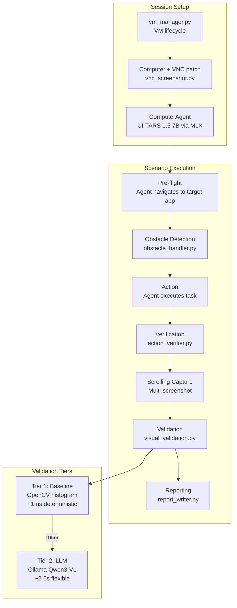
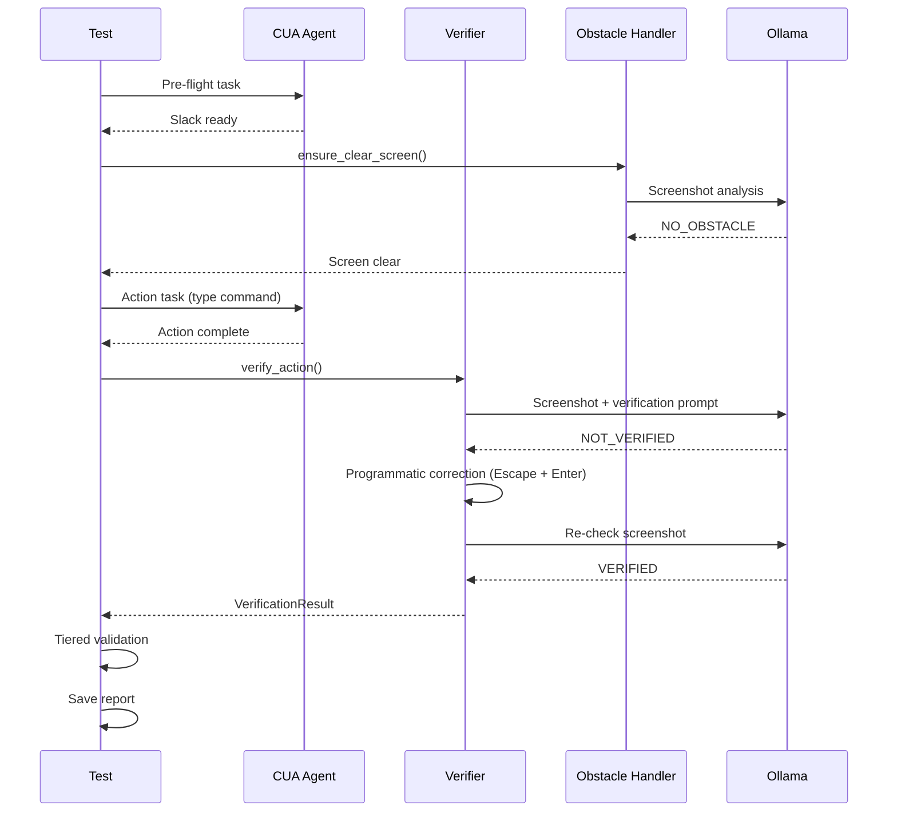

# Desktop Agent: Architecture and Extension Guide

A locally hosted autonomous desktop agent that controls macOS virtual machines through natural language, verifies outcomes with vision models, and self-corrects when actions fail. This document covers the architecture, each component in detail, and how to extend the framework for new use cases.

For quick-start installation and usage, see the [README](../tests/uat/desktop-agent/README.md).

## Architecture Overview

The desktop agent operates in three layers: VM infrastructure, agent execution, and validation. The CUA SDK connects to a Lume macOS VM over REST, a vision-language model (UI-TARS) drives GUI interactions, and a separate vision model (Qwen3-VL via Ollama) verifies outcomes.



## Execution Flow

Each scenario follows a fixed pipeline. The `_run_scenario()` function in `test_slack_visual.py` orchestrates these phases:



## Core Components

### VM Manager (`helpers/vm_manager.py`)

Manages the Lume macOS VM lifecycle. Starts the VM as a background process, polls until responsive (via screenshot API), and grants TCC automation permissions so `osascript` commands can control System Events without triggering permission dialogs.

Key functions:

| Function | Description |
|----------|-------------|
| `ensure_vm_ready(vm_name)` | Start VM if needed, poll until responsive, grant TCC permissions |
| `start_vm(vm_name)` | Boot the VM via `lume run` in the background |
| `stop_vm(vm_name)` | Graceful shutdown via `lume stop` |
| `is_vm_running(vm_name)` | Check status via `lume ls --format json` |

TCC permission grants insert `kTCCServiceAppleEvents` entries for `python3` into the VM's `TCC.db`, allowing `osascript` to control System Events without user interaction. This is a best-effort operation; the correction strategies have timeouts as a fallback.

### VNC Screenshot (`helpers/vnc_screenshot.py`)

Works around a Lume/Apple Virtualization Framework limitation where `CGDisplayCreateImage` returns stale framebuffer data. This module captures screenshots via VNC from the host using `vncdotool`, providing fresh screen content.

Key functions:

| Function | Description |
|----------|-------------|
| `patch_computer_from_lume(computer, vm_name)` | Auto-discovers VNC connection from `lume ls` and patches the Computer |
| `patch_computer_screenshot(computer, host, port, password)` | Monkey-patches `interface.screenshot()` to use VNC |
| `take_vnc_screenshot(host, port, password)` | Captures a single VNC screenshot, returns PNG bytes |

The patch replaces the CUA SDK's built-in screenshot method so all downstream code (verification, validation, capture) automatically uses VNC without any changes.

### Agent Runner (`helpers/agent_runner.py`)

Wraps the CUA SDK's `ComputerAgent.run()` which returns an `AsyncGenerator[dict, None]`. Consumes the generator, extracts text output from structured response dicts, and enforces a step limit to prevent runaway agent loops.

```python
async def run_agent(agent, task: str, *, max_steps: int | None = None) -> str
```

Each yielded dict from the generator contains `{"output": [...], "usage": {...}}`. The runner extracts text content from `output_text` items nested within assistant-role messages.

### Action Verifier (`helpers/action_verifier.py`)

After the CUA agent performs an action, the verifier confirms it succeeded by asking Ollama to analyze a screenshot. If the action failed (e.g. a command was typed but not submitted), it runs escalating programmatic correction strategies.

**Verification loop:**

1. Capture screenshot.
2. Send to Ollama with a verification prompt expecting `VERIFIED` or `NOT_VERIFIED`.
3. If `VERIFIED`, return immediately.
4. If `NOT_VERIFIED`, run the next correction strategy and loop.

**Correction strategies (escalating):**

| Attempt | Strategy | System Events Permission |
|---------|----------|--------------------------|
| 1 | `activate_window(Slack)` then `press_key("escape")` + `press_key("enter")` via SDK | Not required |
| 2 | `activate_window` then clear input, `set_clipboard` + `hotkey("command", "v")` + `press_key("enter")` via SDK | Not required |
| 3 | `activate_window` then `osascript key code 53` (Escape) + `key code 36` (Enter) with timeout | Required |
| 4+ | Full `osascript` sequence: activate app, `Cmd+A`, delete, retype via `keystroke`, Escape, Enter | Required |

Each `osascript` call is wrapped with a 10-second timeout (`_run_with_timeout`) to prevent indefinite hanging when macOS shows a System Events permission dialog.

Key types:

```python
@dataclass
class VerificationResult:
    verified: bool
    screenshot_data: bytes | None
    attempts: int
    observations: str
```

### Obstacle Handler (`helpers/obstacle_handler.py`)

Detects and dismisses unexpected modal dialogs (permission prompts, keychain alerts, software update notifications) that block the target application. Uses Ollama to analyze screenshots and determine whether a blocking dialog is present.

**Detection:** Sends a screenshot with a detection prompt to Ollama, expecting `OBSTACLE_DETECTED` or `NO_OBSTACLE`.

**Resolution strategies (escalating):**

| Strategy | Method | Requires System Events |
|----------|--------|------------------------|
| 1 | `press_key("enter")` via SDK | No |
| 2 | `osascript key code 36` (Enter via System Events) | Yes |
| 3 | `osascript click button "Allow"` on frontmost dialog | Yes |
| 4 | `osascript click button 1` on frontmost dialog | Yes |

Special case: if the obstacle is itself a System Events permission dialog, `osascript` strategies are skipped (they would trigger more of the same dialog).

```python
async def ensure_clear_screen(computer, *, max_attempts: int = 2) -> tuple[bool, str]
```

Returns `(is_clear, message)`. When `is_clear` is `False`, the message starts with `VM_OBSTACLE:` to distinguish infrastructure issues from test failures.

### Visual Validation (`helpers/visual_validation.py`)

Provides the prompts, screenshot utilities, and tiered validation logic.

**Tiered validation (`validate_with_baseline`):**

1. **Tier 1 -- Baseline comparison** (~1ms): compares the current screenshot against a stored baseline using OpenCV histogram correlation. If similarity exceeds 0.92, the test passes without involving an LLM.
2. **Tier 2 -- LLM validation** (~2-5s): sends the screenshot(s) to Ollama with a scenario-specific prompt expecting `PASS` or `FAIL`.

When a test passes via Tier 2 and `--update-baselines` is set, the screenshot is saved as a new baseline for future runs.

**Multi-screenshot support:** `capture_scrolling_screenshots()` presses Page Up to reveal content above the fold, captures a screenshot after each scroll, detects when it reaches the top (via similarity threshold), and restores the original scroll position. Screenshots are passed to validation in top-to-bottom reading order.

**Prompt dictionaries:**

- `VALIDATION_PROMPTS`: per-scenario prompts describing what a correct result looks like.
- `VERIFICATION_HINTS`: per-scenario freshness anchoring text injected into the verification prompt to distinguish stale responses from new ones.
- `SCENARIO_METADATA`: maps each test ID to responsible source files and investigation hints for bug triage.

### Ollama Validator (`helpers/ollama_validator.py`)

Thin wrapper around Ollama's OpenAI-compatible `/v1/chat/completions` endpoint. Encodes screenshots as base64 PNG images in the message content array. Supports multi-image input with an automatic context preamble.

```python
async def validate_with_ollama(screenshot_data: bytes | list[bytes], prompt: str) -> str
async def is_ollama_available() -> bool
```

Configuration: `DESKTOP_UAT_OLLAMA_URL`, `DESKTOP_UAT_OLLAMA_MODEL`, `DESKTOP_UAT_OLLAMA_TIMEOUT`.

### Baseline Manager (`helpers/baseline_manager.py`)

Deterministic, fast (~1ms) image comparison using OpenCV HSV histogram correlation. Provides the Tier 1 validation gate that eliminates non-deterministic LLM flicker for stable screens.

Key functions:

| Function | Description |
|----------|-------------|
| `check_baseline(baselines_dir, test_id, command, screenshot)` | Load baseline and compare; returns `(matches, score)` |
| `compare_screenshots(baseline, current)` | HSV histogram correlation, returns 0.0-1.0 |
| `save_baseline(baselines_dir, params_hash, screenshot)` | Store a PNG as a new baseline |
| `compute_params_hash(test_id, command)` | SHA-256 hash of test parameters for stable file naming |

### Report Writer (`helpers/report_writer.py`)

Generates structured JSON reports with session-level aggregation, timestamped screenshots, and a `latest.json` symlink for easy access.

```python
@dataclass
class ScenarioResult:
    test_id: str
    name: str
    command: str
    passed: bool
    duration_seconds: float
    agent_observations: str
    screenshots: list[str]
    issues: list[str]

@dataclass
class UATSession:
    date: str
    phase: str
    total: int
    passed: int
    failed: int
    pass_rate: str
    total_duration_seconds: float
    tests: list[ScenarioResult]
```

## CUA SDK Patches

The `conftest.py` fixture file applies four compatibility patches at import time. These are necessary because the CUA SDK (v0.7.26), mlx-vlm, and transformers have interoperability gaps when running UI-TARS locally.

### Patch 1: Transformers video processor stub

Transformers >=5.1 crashes in MLX-only environments because `video_processor_class_from_name` iterates mapping values that are `None` when PyTorch is not installed. A stub module is pre-registered in `sys.modules` to prevent the crash. UI-TARS only processes still images, so video processing is unused.

### Patch 2: ProcessorMixin lenient type check

`Qwen2VLProcessor.__init__` receives `None` for `video_processor` (from the stub above), which the type check rejects. The patch allows `None` to pass through since video processing is unused.

### Patch 3: mlx-vlm generate() compatibility

mlx-vlm >=0.3 changed `generate()` to return a `GenerationResult` dataclass instead of a `(text, usage)` tuple. The CUA SDK adapter (v0.7.26) still unpacks it as a tuple. The patch wraps `generate()` to return a tuple again.

### Patch 4: UI-TARS Enter key fix

This is the most critical patch. UI-TARS is trained to append `\n` to `type(content)` when it wants to submit (press Enter). CUA SDK's `convert_to_computer_actions()` passes the `\n` as literal text to `type_text()`, which the VM's REST API silently drops. The patch strips trailing `\n` from type actions and emits a separate sequence: `keypress(["escape"])` (dismisses Slack's autocomplete dropdown) + `keypress(["enter"])`.

This matches the behavior of UI-TARS Desktop (ByteDance's NutJS operator), which handles the `\n` → Enter translation natively.

## Extending to Other Use Cases

### Scenario Structure

Each test scenario follows the pattern defined by `_run_scenario()`:

```python
result = await _run_scenario(
    agent,
    computer,
    test_id="MY-001",
    name="My Scenario",
    command="/some-command",
    wait_seconds=5,
    report_dir=report_dir,
)
```

The function executes: pre-flight, obstacle check, before screenshot, input cleanup, action, verification, scrolling capture, tiered validation, and reporting.

### Writing New Scenarios

1. **Define the scenario** as a new pytest test function:

```python
@pytest.mark.desktop_agent
@pytest.mark.asyncio
async def test_my_scenario(agent, computer, report_dir, test_session, update_baselines):
    result = await _run_scenario(
        agent, computer,
        test_id="MY-001",
        name="My Scenario Description",
        command="/my-command arg1 arg2",
        wait_seconds=8,
        report_dir=report_dir,
        update_baselines=update_baselines,
    )
    test_session.tests.append(result)
    assert result.passed, f"MY-001 failed: {result.agent_observations[:300]}"
```

2. **Add a validation prompt** in `VALIDATION_PROMPTS`:

```python
VALIDATION_PROMPTS["MY-001"] = (
    "Look at the application's most recent response. "
    "Does it display [expected content]? "
    "Check for: (1) [criterion], (2) [criterion]. "
    "Report PASS if [conditions], FAIL otherwise."
)
```

3. **Add a verification hint** in `VERIFICATION_HINTS`:

```python
VERIFICATION_HINTS["MY-001"] = (
    "A fresh response should be the LAST message, directly below "
    "the sent command. Contains [distinguishing content]. "
    "If it appears higher up, it is STALE."
)
```

### Swapping the Target Application

To use the agent with a different application:

1. **Update the pre-flight task** (`PREFLIGHT_TASK` in `visual_validation.py`):

```python
PREFLIGHT_TASK = (
    "Look at the screen. Verify that [Your App] is open and showing "
    "[expected state]. If [Your App] is not in the foreground, click "
    "on it in the dock. Confirm when ready."
)
```

2. **Update `_activate_slack()`** in `action_verifier.py` to target your app:

```python
async def _activate_app(iface):
    windows = await iface.get_application_windows("Your App Name")
    if windows:
        window_id = windows[0] if isinstance(windows, list) else windows
        await iface.activate_window(window_id)
```

3. **Update the full osascript sequence** in `_programmatic_correction()` to activate the correct application.

4. **Adjust the Enter key patch** in `conftest.py` if your target app does not have an autocomplete dropdown that intercepts Enter (you can remove the Escape keypress).

### Custom Validation Prompts

Effective prompts follow these patterns (learned from 100+ test iterations):

- **Be specific** about what to look for: counts, names, formatting markers.
- **Distinguish fresh from stale** content using position-based language ("the LAST message", "directly below the command").
- **Request explicit verdicts**: end with "Report PASS if ... FAIL otherwise."
- **Include expected values** for comparison when possible.

### Beyond Command-and-Response

For scenarios that do not follow the "type command, verify response" pattern, you can write custom flows directly. VIS-006 (thread context) and VIS-007 (response timing) in the reference implementation demonstrate multi-step flows with custom action sequences.

The core helpers (`capture_screenshot`, `verify_action`, `ensure_clear_screen`, `validate_with_baseline`) are all independently callable.

## Operational Considerations

### VM Snapshot Management

Lume v0.2.80 does not support snapshots. For reproducible test runs, prepare a VM image with:
- The target application installed and signed in.
- System dialogs pre-dismissed (or grant TCC permissions via `vm_manager._grant_automation_permissions`).
- Notification Center set to Do Not Disturb.

### Model Requirements

| Role | Model | Purpose | Memory |
|------|-------|---------|--------|
| Action | UI-TARS 1.5 7B (6-bit MLX) | GUI automation | ~5.5 GB |
| Verification | Qwen3-VL 8B (Ollama) | Screenshot analysis | ~5 GB |

Both models run concurrently on Apple Silicon. An M3 Max with 36 GB unified memory handles both comfortably.

### Cost Tradeoffs

| Approach | Cost | Speed | Accuracy |
|----------|------|-------|----------|
| Local MLX + Ollama | Free | ~3-6s per agent step, ~2-5s per verification | Good for structured UI |
| Claude Sonnet (agent) + Ollama (verify) | ~$0.10/test | ~2s per agent step | Best overall |
| Claude Sonnet (agent + verify) | ~$0.50/test | Fastest | Highest |

### CI/CD Integration

For headless macOS runners (e.g. GitHub Actions with macOS images):
- Install Lume and provision the VM in a setup step.
- Start Ollama and pull `qwen3-vl:8b` in a setup step.
- Set `DESKTOP_UAT_KEEP_VM=1` if running multiple test suites.
- The agent model (UI-TARS) is downloaded on first run (~4 GB); cache `~/.cache/huggingface/` across runs.

## Troubleshooting

### Command typed but not submitted

**Symptom:** The agent types text into an input field but never presses Enter. The text remains in the field after the test completes.

**Cause:** CUA SDK's `convert_to_computer_actions()` does not translate UI-TARS' `\n` convention into an Enter keypress. The `\n` is passed as literal text and silently dropped by the VM's REST API.

**Fix:** The Enter key patch in `conftest.py` (Patch 4) handles this. If you are still seeing the issue, verify the monkeypatch is being applied by checking for the `[fixture:computer]` log line at test start.

### System dialogs blocking tests

**Symptom:** Tests fail with `VM_OBSTACLE:` in the error message, or the agent interacts with a dialog instead of the target application.

**Fix:** Grant automation permissions on the VM. `ensure_vm_ready()` does this automatically via TCC.db, but it requires SIP to be relaxed for the TCC database. Alternatively, manually grant permissions in System Settings > Privacy & Security > Automation on the VM.

### Stale or frozen screenshots

**Symptom:** Screenshots show the same image regardless of what changes on screen.

**Cause:** `CGDisplayCreateImage` returns cached framebuffer data in Lume VMs (Apple Virtualization Framework limitation).

**Fix:** The VNC screenshot patch in `vnc_screenshot.py` handles this. Verify `vncdotool` is installed (`uv pip install vncdotool`) and that the VM has a VNC URL visible in `lume ls --format json`.

### Focus lost after agent action

**Symptom:** Correction strategies silently fail because keyboard input goes to the wrong window.

**Fix:** The verifier calls `_activate_slack(iface)` (or your equivalent `_activate_app`) before every correction attempt, using `get_application_windows()` + `activate_window()` which raises on failure (unlike keyboard methods that silently return `None`).

### osascript commands hang indefinitely

**Symptom:** A test hangs for a long time, then continues after a timeout.

**Cause:** macOS shows a "python3 wants access to control System Events" dialog, which blocks the `osascript` process.

**Fix:** Grant TCC automation permissions (see "System dialogs blocking tests" above). The framework wraps all `osascript` calls with a 10-second timeout to prevent indefinite hanging.

## Design Decisions

### Why two separate vision models?

UI-TARS excels at GUI navigation (clicking, typing, scrolling) but is unreliable at judgment tasks ("did this action succeed?"). Qwen3-VL excels at screenshot analysis and reasoning but cannot drive GUI actions. Using both plays to each model's strengths.

### Why escalating correction strategies?

The CUA agent fails to press Enter approximately 30-50% of the time with UI-TARS 7B. Rather than re-invoking the unreliable agent, the verifier uses deterministic programmatic methods. Strategies escalate from cheap SDK calls (no permissions needed) to osascript (requires System Events permission) to full shell sequences (last resort).

### Why tiered validation?

LLM validation introduces non-deterministic PASS/FAIL flicker -- the same screenshot may get different verdicts across runs. Baseline comparison provides a deterministic fast path for stable screens. The LLM is only consulted when the screen changes (new content, different layout) or no baseline exists.

### Why VNC screenshots instead of the CUA SDK's built-in method?

The CUA SDK captures screenshots via `CGDisplayCreateImage`, which returns stale framebuffer data in Apple Virtualization Framework VMs. VNC reads the actual framebuffer from the guest OS, providing current screen content.
