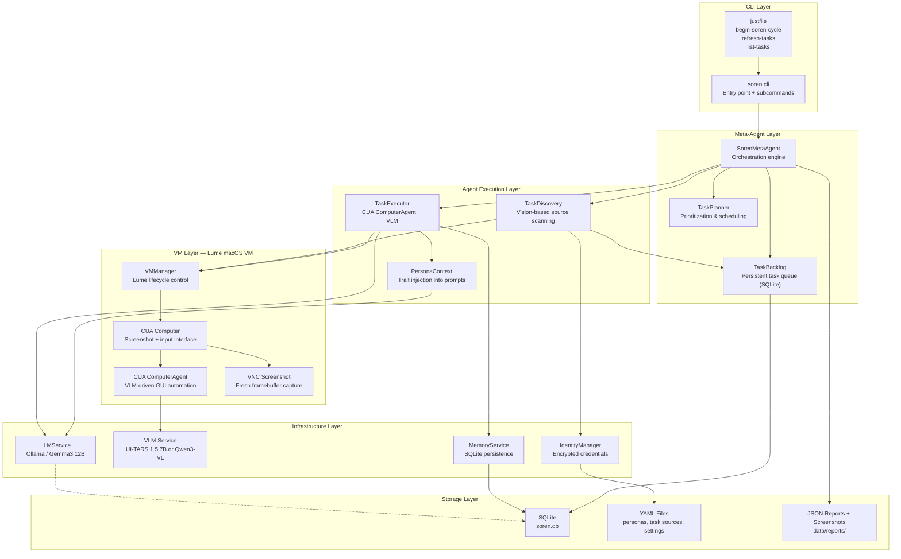
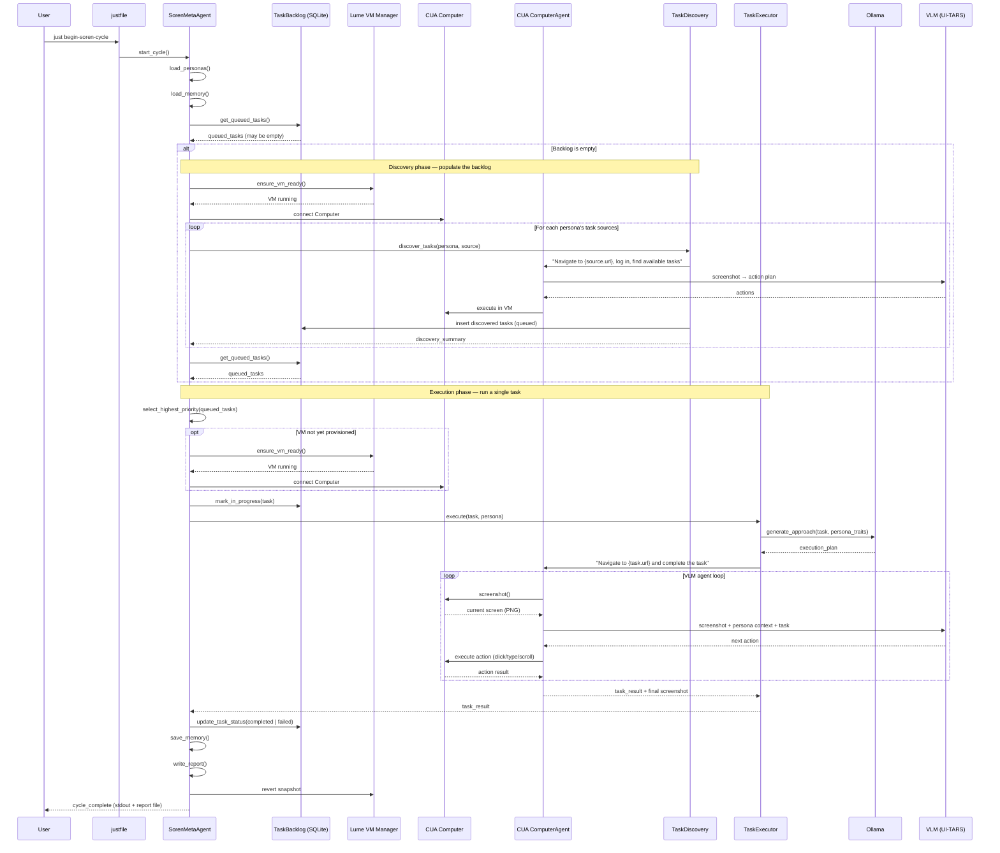
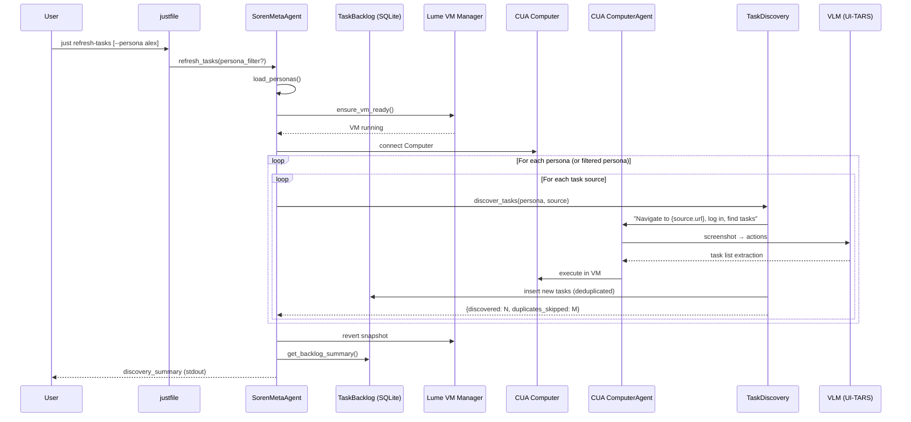
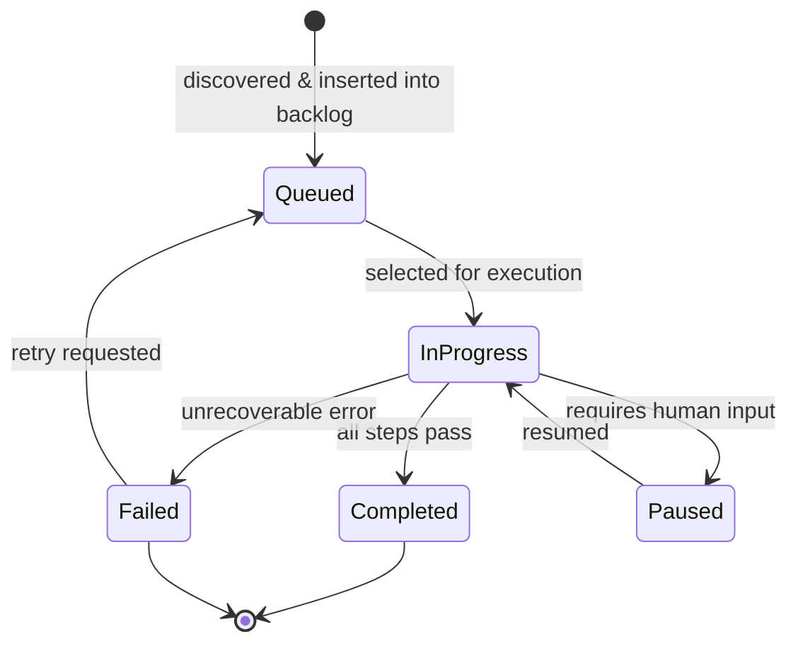
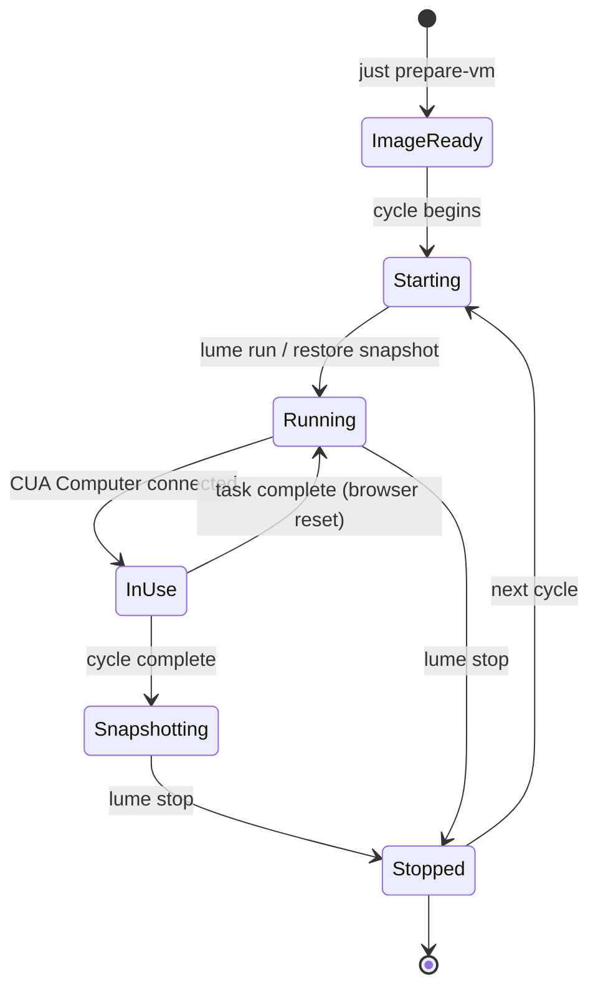
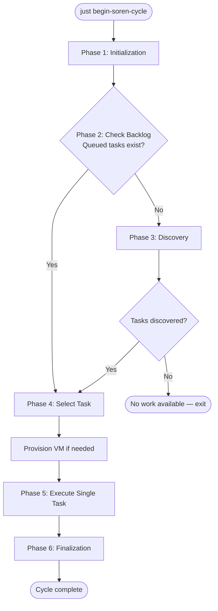

# Soren Desktop Agent Framework -- Product Requirements Document

**Version**: 3.1
**Date**: February 23, 2026
**Status**: Draft (Revised)

---

## 1. Executive Summary

The Soren Desktop Agent Framework is a locally hosted, CLI-driven autonomous agent system that discovers tasks from external web services and executes them through vision-based GUI automation inside isolated macOS virtual machines.

**Discovery and execution are decoupled.** Each persona is configured with one or more **task sources** -- external services where work can be found (survey platforms, email inboxes, form dashboards). When the meta-agent discovers tasks from these sources, it writes them to a **persistent task backlog** stored in SQLite. When the meta-agent runs an execution cycle, it pulls tasks from the backlog rather than discovering them inline. This separation means discovery can be triggered independently (`just refresh-tasks`), tasks accumulate between cycles, and each execution cycle focuses on completing work rather than searching for it.

A meta-agent named Soren orchestrates both phases. In a standard cycle (`just begin-soren-cycle`), Soren checks the task backlog: if queued tasks exist, it provisions a Lume macOS VM and executes a single task using the appropriate persona; if the backlog is empty, it first runs discovery across all configured task sources to populate the backlog, then executes. Tasks are executed by a `ComputerAgent` (from the CUA Agent SDK) that interacts with the VM through screenshots and simulated input -- the same way a human would use a computer. This vision-based approach controls a real browser with real cookies, extensions, and rendering, avoiding the detection and restriction problems that plague headless browser automation tools like Playwright or Selenium.

As the agent completes tasks, it writes back what it learned to **per-service playbook files** -- human-readable markdown documents that accumulate step-by-step workflow instructions (e.g., "how to log into Gmail and reply to an email"). On future cycles, these playbooks are loaded into the agent's prompt so it can follow known-good procedures instead of rediscovering them.

The framework runs entirely on the user's Apple Silicon Mac. There is no cloud backend. Personas, credentials, task backlogs, playbooks, memory, and task history live in local files and a SQLite database. Lume manages macOS VM lifecycle using Apple's native Virtualization Framework.

---

## 2. Problem Statement

Repetitive web-based tasks -- completing surveys, responding to emails, filling out forms, drafting proposals -- consume significant time and follow predictable patterns that an AI agent can handle. Existing automation tools face compounding challenges:

- **Browser automation detection**: Modern web services actively detect and block headless browsers (Playwright, Selenium, Puppeteer). Bot detection systems fingerprint browser environments, flag missing GPU rendering, identify automation driver signatures, and reject requests from non-standard browser configurations. This makes DOM-based automation increasingly unreliable for real-world task execution.
- **Scripting brittleness**: Page selectors break when services update their UI. Each service requires custom adapter code that must be maintained against frequent layout changes.
- **Lack of adaptability**: Traditional automation cannot handle unexpected modals, layout variations, or multi-step flows that deviate from the scripted path.
- **Privacy and cost**: Cloud-based AI agents require sending credentials and personal data to external services.

The gap is a **local, vision-based orchestrator** that can:

- Discover what work is available across multiple services without manual curation.
- Decide how to approach each task based on a configurable identity (persona).
- Execute tasks by controlling a real browser inside an isolated VM -- the same way a human would -- using screenshots and input simulation rather than DOM manipulation.
- Avoid automation detection entirely because the browser is a standard macOS browser with full rendering, real cookies, and no automation driver signatures.
- Learn from past sessions to improve reliability and reduce repeated mistakes.
- Run entirely on consumer Apple Silicon hardware with no external API dependencies.

---

## 3. Goals and Non-Goals

### Goals (v1)

1. **Decoupled discovery and execution**: Task discovery and task execution are separate operations. Discovery populates a persistent task backlog; execution draws from it. Either phase can run independently.
2. **Persistent task backlog**: Discovered tasks are stored in SQLite and persist across cycles. The backlog accumulates tasks from multiple discovery runs and tracks their lifecycle (queued, in_progress, completed, failed).
3. **Single-command execution**: `just begin-soren-cycle` checks the backlog, discovers tasks if empty, and executes a single task. `just refresh-tasks` triggers discovery independently.
4. **Meta-agent orchestration**: Soren decides whether to discover or execute based on backlog state, matches tasks to personas, and manages the full lifecycle.
5. **Persona-driven task sources**: Each persona is configured with one or more task sources (external services). Task sources define where discovery scans for work and how tasks are categorized.
6. **Persona-driven behavior**: Each persona has configurable traits (personality, demographics, communication style) stored as YAML that influence how the VLM agent generates responses and interacts with the GUI.
7. **VM-isolated execution**: Each task runs inside a Lume macOS VM, providing full OS-level isolation between personas and tasks. The agent controls a real browser through vision-based GUI interaction, avoiding automation detection.
8. **Vision-based task execution**: A CUA `ComputerAgent` driven by a vision-language model takes screenshots, reasons about UI state, and executes mouse/keyboard actions to complete tasks -- the same way a human would.
9. **Local LLM inference**: Reasoning and content generation run through Ollama with Gemma3:12B. Vision grounding uses a locally-hosted VLM (UI-TARS 1.5 7B via MLX or Ollama).
10. **Persistent memory**: Session context, task outcomes, and learned patterns survive across cycles in a SQLite database.
11. **Encrypted credential storage**: Service credentials are encrypted at rest and scoped per persona.
12. **Structured logging and reporting**: Each cycle produces a JSON report with task outcomes, timing, screenshots, and error details.

### Non-Goals (v1)

- Web-based UI or dashboard (CLI and log files only).
- Multi-user support (single operator, multiple personas).
- Cloud LLM fallback (local models only; no OpenAI/Anthropic API calls).
- Linux VM support via Docker/QEMU (deferred; macOS VMs via Lume only in v1).
- Real-time chat interface with Soren (batch cycle execution only).
- Concurrent multi-VM execution (one VM at a time in v1).
- Desktop application automation beyond the browser (browser-only task execution in v1).

---

## 4. User Stories

### US-1: Run an Execution Cycle

> As a user, I run `just begin-soren-cycle` and Soren checks the task backlog. If tasks are queued, it provisions a VM and executes a single task. If the backlog is empty, it first runs discovery across all configured task sources to populate the backlog, then executes the highest-priority task. Either way, a summary report is produced without further interaction.

**Acceptance Criteria**:
- The command starts Ollama and the Lume HTTP server if not already running.
- Soren loads all active personas and their task source configurations.
- The task backlog (SQLite) is queried for tasks with `queued` status.
- **If queued tasks exist**: the highest-priority task is selected for execution.
- **If no queued tasks exist**: Soren runs discovery across all persona task sources inside the VM, populates the backlog, and then selects the highest-priority newly discovered task.
- A macOS VM is provisioned (started or restored from snapshot) for execution.
- The selected task is executed by a CUA ComputerAgent with the persona context.
- A JSON report is written to `data/reports/` with the task result and screenshots.
- Failed tasks remain in the backlog with `failed` status for retry.
- The VM is reverted to its clean snapshot after the cycle completes.

### US-2: Add a New Persona

> As a user, I create a YAML file in `config/personas/` describing a new persona's traits, demographics, and task sources. On the next cycle, Soren uses this persona for task discovery and execution.

**Acceptance Criteria**:
- Persona YAML is validated on load (required fields, value constraints).
- Invalid persona files produce clear error messages and are skipped.
- The persona appears in cycle reports with its assigned tasks.

### US-3: Add a Task Source to a Persona

> As a user, I add a `task_sources` entry to a persona's YAML with the source URL, type, credential reference, and optional discovery hint. I encrypt the credentials via `just encrypt-credentials`. On the next discovery run, Soren scans this source.

**Acceptance Criteria**:
- Credentials are encrypted before being written to disk.
- The `just encrypt-credentials` helper encrypts plaintext credentials.
- Login is performed inside the VM's browser via the CUA ComputerAgent (type username, type password, click login -- all vision-based).
- Failed logins are retried once, then marked as an error with a screenshot.
- The source's `discovery_hint` is included in the VLM agent's instructions.

### US-4: Review Cycle History

> As a user, I run `just show-history` to see a table of recent cycles with pass/fail counts and total duration.

**Acceptance Criteria**:
- Reads from the SQLite database.
- Displays the last 10 cycles by default, configurable via `--limit`.

### US-5: Retry Failed Tasks

> As a user, I run `just retry-failed` to move tasks with `failed` status in the backlog back to `queued`. The next `just begin-soren-cycle` will pick them up.

**Acceptance Criteria**:
- Only tasks with `failed` status are moved back to `queued`.
- Optionally specify `--task <id>` to retry a specific task.
- Prints a summary of how many tasks were requeued.
- No VM is provisioned; this is a database-only operation.

### US-6: Prepare a VM Image

> As a user, I run `just prepare-vm` to create a pre-configured macOS VM image with a browser installed and ready for use. This is a one-time setup step.

**Acceptance Criteria**:
- Lume pulls or creates a macOS VM image.
- The VM is booted, Safari/Chrome is verified as available, and screen resolution is configured.
- A clean snapshot is saved as the baseline for future cycles.
- The command reports the VM name and image size on completion.

### US-7: Refresh Tasks from Sources

> As a user, I run `just refresh-tasks` (optionally with `--persona <name>`) to trigger task discovery across all configured task sources. Discovered tasks are added to the backlog without executing any of them.

**Acceptance Criteria**:
- A VM is provisioned for the discovery session.
- For each persona (or the specified persona), Soren scans all enabled task sources.
- Newly discovered tasks are inserted into the backlog with `queued` status.
- Duplicate tasks (same source URL, already in backlog) are skipped.
- A summary is printed: tasks discovered per persona, duplicates skipped, total backlog size.
- The VM is reverted to its clean snapshot after discovery completes.

### US-8: View the Task Backlog

> As a user, I run `just list-tasks` to see all tasks in the backlog, filterable by persona, status, and task type.

**Acceptance Criteria**:
- Reads from the SQLite database without provisioning a VM.
- Displays tasks in a table with columns: persona, source, title, type, status, priority, discovered date.
- Supports filters: `--persona <name>`, `--status <status>`, `--type <type>`.
- Supports `--limit <n>` (default 25).
- Shows a backlog summary at the bottom: total tasks, queued, in_progress, completed, failed.

### US-9: Configure a Task Source for a Persona

> As a user, I add a `task_sources` entry to a persona's YAML file, specifying the service URL, service type, and discovery schedule. On the next discovery run, Soren includes this source.

**Acceptance Criteria**:
- Persona YAML is validated on load; invalid `task_sources` entries produce clear errors.
- Each task source has a `type`, `name`, `url`, and `credential_ref`.
- The persona's task source list appears in `just list-personas` output.

---

## 5. System Architecture

### Component Overview



### Data Flow: Execution Cycle (`just begin-soren-cycle`)



### Data Flow: Discovery Only (`just refresh-tasks`)



---

## 6. Core Components

### 6.1 Meta-Agent (Soren Orchestrator)

The central orchestration engine. Soren owns two primary operations -- **discovery** (populating the task backlog) and **execution** (completing tasks from the backlog) -- plus the decision logic that determines which operation to run.

**Responsibilities**:
- Load and validate all persona configurations and their task sources.
- Restore memory from previous cycles.
- **Backlog assessment**: Query the persistent task backlog for queued tasks.
- **Conditional discovery**: If the backlog is empty (or discovery is explicitly requested), provision a VM and run discovery across all persona task sources.
- **Task selection**: Choose the highest-priority task from the backlog based on composite scoring (estimated reward, persona fit, historical success rate, age in backlog).
- **Execution**: Provision a VM (if not already running from discovery), execute a single task using the CUA ComputerAgent with persona context.
- Handle top-level errors and decide whether to retry, skip, or abort.
- Persist updated memory, update the backlog, and write the cycle report.
- Revert the VM to a clean snapshot after cycle completion.

**Key interface**:

```python
class SorenMetaAgent:
    def __init__(self, config: SorenConfig):
        self.config = config
        self.personas = PersonaLoader.load_all(config.personas_dir)
        self.memory = MemoryService(config.database_path)
        self.backlog = TaskBacklog(config.database_path)
        self.llm = LLMService(config.ollama_url, config.model)
        self.vm_manager = VMManager(config.vm)
        self.computer: Computer | None = None

    async def run_cycle(self) -> CycleReport:
        """Check backlog → discover if empty → execute one task → teardown."""
        queued = await self.backlog.get_queued_tasks()
        if not queued:
            await self._run_discovery()
            queued = await self.backlog.get_queued_tasks()
        if queued:
            task = self._select_highest_priority(queued)
            await self._execute_task(task, self._persona_for(task))
        ...

    async def refresh_tasks(self, persona_filter: str | None = None) -> DiscoverySummary:
        """Discovery-only mode: scan all task sources, populate backlog, no execution."""
        ...

    async def _run_discovery(self, persona_filter: str | None = None) -> list[Task]:
        """Provision VM and discover tasks across all persona task sources."""
        ...

    async def _execute_task(self, task: Task, persona: Persona) -> TaskResult:
        """Execute a single task using the CUA ComputerAgent with persona context."""
        ...

    async def _ensure_vm(self) -> Computer:
        """Start or restore the Lume VM and return a connected CUA Computer."""
        ...

    def _select_highest_priority(self, tasks: list[Task]) -> Task:
        """Score and rank tasks by reward, persona fit, age, and history."""
        ...
```

### 6.2 Persona System

Personas are YAML-defined agent identities. Each persona has traits that are injected into LLM prompts to shape response generation, behavioral preferences that influence browser interaction patterns (typing speed, pause duration, response style), and **task sources** that define where the persona discovers work.

**Persona attributes**:
- `name`: Human-readable identifier.
- `description`: Purpose and role.
- `personality_traits`: List of trait keywords (analytical, cautious, friendly).
- `behavioral_preferences`: Risk tolerance, communication style, decision speed.
- `demographic_profile`: Age range, education, interests -- used for survey responses.
- `task_sources`: List of external services where this persona discovers tasks. Each source has a type, name, URL, credential reference, and optional discovery instructions.

```yaml
# config/personas/researcher.yaml
name: "Alex Chen"
description: "Detail-oriented researcher focused on technology surveys"

personality_traits:
  - analytical
  - thorough
  - patient
  - tech-savvy

behavioral_preferences:
  risk_tolerance: conservative
  communication_style: formal
  decision_speed: deliberate
  typing_speed: moderate

demographic_profile:
  age_range: "28-35"
  education_level: "masters"
  occupation: "software_engineer"
  income_bracket: "upper_middle"
  interests:
    - technology
    - science
    - productivity
    - finance

task_sources:
  - type: survey_platform
    name: "Survey Junkie"
    url: "https://www.surveyjunkie.com/surveys"
    credential_ref: "survey_junkie_alex"
    enabled: true
    discovery_hint: "Look for available surveys showing reward amount and estimated time"
  - type: email
    name: "Gmail"
    url: "https://mail.google.com"
    credential_ref: "gmail_alex"
    enabled: true
    discovery_hint: "Find unread emails that require a response"
  - type: generic_form
    name: "Prolific"
    url: "https://app.prolific.com/studies"
    credential_ref: "prolific_alex"
    enabled: true
    discovery_hint: "Find available studies with their reward and estimated completion time"
```

Each `task_source` entry tells the discovery engine where to scan and provides a `discovery_hint` -- a natural language nudge that is appended to the VLM agent's instructions to guide its search. The `credential_ref` links to an encrypted credential used for login.

### 6.3 Task Discovery Engine

Discovers actionable work items from external services by directing the CUA ComputerAgent to navigate the VM's browser. Discovery is a **standalone operation** that can be triggered independently of execution (`just refresh-tasks`) or as part of a cycle when the backlog is empty. Discovered tasks are written to the **persistent task backlog** in SQLite.

Each service type has a discovery adapter that provides the VLM agent with navigation instructions and extraction prompts. The persona's `discovery_hint` is appended to the adapter's instructions to further guide the agent. Unlike DOM-based scraping, discovery operates through visual analysis of screenshots, making it resilient to UI changes and invisible to bot detection.

**Discovery adapter interface**:

```python
class DiscoveryAdapter(Protocol):
    service_type: str

    def login_instructions(self, credentials: Credentials) -> str:
        """Natural language instructions for the VLM agent to log into the service."""
        ...

    def discovery_instructions(self, source: TaskSource) -> str:
        """Natural language instructions for the VLM agent to find available tasks.
        Incorporates the source's discovery_hint if provided."""
        ...

    def parse_discovered_tasks(self, agent_output: str, source: TaskSource) -> list[DiscoveredTask]:
        """Parse the VLM agent's structured output into task objects.
        Each task is tagged with the source persona and source reference."""
        ...
```

**Built-in adapters (v1)**:
- `SurveyPlatformAdapter`: Instructs the agent to navigate to the survey dashboard, identify available surveys (title, estimated duration, reward), and report them as structured output.
- `EmailAdapter`: Instructs the agent to open the inbox, identify unread emails requiring responses, and extract sender/subject/preview.
- `GenericFormAdapter`: Instructs the agent to navigate to a configured URL and identify fillable forms.

The adapter does not control the browser directly. It produces natural language instructions that the `ComputerAgent` executes vision-first. This makes adapters lightweight -- typically 50-100 lines of prompt engineering rather than hundreds of lines of selector-based scraping code.

**Backlog insertion**: After discovery, each task is deduplicated against existing backlog entries (by `source_url` + `persona_id`). New tasks are inserted with `queued` status and a discovery timestamp. Duplicate tasks that are already `queued` or `in_progress` are skipped; tasks that previously `failed` or were `completed` can optionally be rediscovered (configurable).

**Task Backlog interface**:

```python
class TaskBacklog:
    def __init__(self, database_path: str):
        ...

    async def get_queued_tasks(self, persona_id: str | None = None) -> list[Task]:
        """Return all tasks with queued status, optionally filtered by persona."""
        ...

    async def insert_discovered(self, tasks: list[DiscoveredTask]) -> InsertResult:
        """Deduplicate and insert newly discovered tasks. Returns counts."""
        ...

    async def mark_in_progress(self, task_id: str) -> None:
        ...

    async def mark_completed(self, task_id: str, result: TaskResult) -> None:
        ...

    async def mark_failed(self, task_id: str, error: TaskError) -> None:
        ...

    async def get_summary(self) -> BacklogSummary:
        """Return counts by status, persona, and source."""
        ...

    async def requeue_failed(self, task_id: str | None = None) -> int:
        """Move failed tasks back to queued. If task_id is None, requeue all failed."""
        ...
```

**Task lifecycle**:



### 6.4 Task Executor

Drives the CUA ComputerAgent to complete a task inside the Lume VM. The executor wraps the ComputerAgent's built-in agent loop with Soren-specific concerns: persona context injection, step budgets, verification, and memory recording.

The ComputerAgent operates autonomously: it takes a screenshot, sends it to the VLM along with the task instructions, receives an action (click at coordinates, type text, scroll, press key), executes the action in the VM via the CUA Computer interface, and loops until the task is complete or the step budget is exhausted.

**Execution loop**:

1. Build the agent prompt: task description + persona context + relevant memories + **service playbook** (if one exists for the target service).
2. Create a `ComputerAgent` instance with the VLM model and the connected `Computer`.
3. Pass the prompt as the initial message to `agent.run()`.
4. The ComputerAgent autonomously loops:
   a. Capture screenshot from the VM (via VNC for fresh framebuffer data).
   b. Send screenshot + conversation history to the VLM.
   c. VLM returns next action: `click(x, y)`, `type(text)`, `scroll(direction)`, `key_press(key)`.
   d. CUA Computer executes the action in the VM.
   e. Agent captures result and continues.
5. Monitor the agent's output stream for completion signals or error conditions.
6. On completion, capture a final screenshot and extract the task outcome.
7. Record step results, screenshots, and timing to the task record.
8. On success, trigger a **playbook write-back**: the reasoning LLM summarizes the step log into reusable instructions and appends them to the service's playbook (see Section 6.9).

**Step budget**: Each task has a configurable maximum number of agent steps (default: 50). This prevents runaway loops on tasks the agent cannot solve.

**Verification tiers** (adapted from desktop-agent.md):
- **Tier 1 -- Baseline comparison** (~1ms): Compare the current screenshot against a stored baseline using OpenCV histogram correlation. If similarity exceeds the threshold, the action is confirmed without involving the LLM.
- **Tier 2 -- VLM Verification** (~2-5s): Send the screenshot to the verification VLM (Qwen3-VL via Ollama) with a verification prompt expecting `VERIFIED` or `NOT_VERIFIED`. Used when the screen state is novel or Tier 1 is inconclusive.

**Correction strategies** (escalating, from desktop-agent.md):
1. Re-prompt the ComputerAgent with explicit instructions about what failed.
2. Programmatic keypress correction: Escape (dismiss modals) + Enter (submit pending input).
3. osascript-based window activation and input replay (requires TCC permissions in the VM).
4. Full osascript sequence: activate app, select all, delete, retype, submit.

### 6.5 Memory System

Provides persistent context that survives across cycles. Memory is stored in a local SQLite database and organized into three tiers:

| Tier | Scope | Lifetime | Storage |
|------|-------|----------|---------|
| Session memory | Single task execution | Discarded after task completes | In-memory |
| Cycle memory | One `begin-soren-cycle` run | Retained for reporting, pruned after 30 days | SQLite |
| Long-term memory | Cross-cycle knowledge | Indefinite, importance-scored | SQLite |

**Long-term memory entries** include:
- Service navigation patterns (login flows, task listing locations).
- Persona-specific response patterns that led to successful task completion.
- Error patterns and successful recovery strategies.
- Entity relationships (service X has survey type Y that persona Z handles well).

**Memory operations**:

```python
class MemoryService:
    def store(self, key: str, value: Any, importance: float = 0.5, ttl: int | None = None) -> None:
        """Store a memory entry with importance scoring."""
        ...

    def recall(self, query: str, limit: int = 10) -> list[MemoryEntry]:
        """Retrieve relevant memories by semantic similarity or keyword match."""
        ...

    def prune(self, threshold: float = 0.2) -> int:
        """Remove low-importance entries that have aged past their retention window."""
        ...
```

**Importance scoring**: Each memory entry has a score from 0.0 to 1.0. Scores decay over time unless the entry is accessed (boosted on recall). Entries below the configurable threshold are pruned during the cleanup phase at cycle end.

### 6.6 VM Manager (Lume Integration)

Manages the lifecycle of the Lume macOS VM that serves as the sandboxed execution environment. The VM runs a full macOS instance with a real browser, providing a genuine user environment that is invisible to bot detection.

**VM lifecycle**:



**Key functions**:

```python
class VMManager:
    def __init__(self, config: VMConfig):
        self.config = config
        self.vm_name = config.vm_name
        self.lume_url = config.lume_url

    async def ensure_ready(self) -> None:
        """Start the VM if not running. Restore from clean snapshot if available."""
        ...

    async def connect_computer(self) -> Computer:
        """Return a CUA Computer connected to the running VM."""
        ...

    async def take_snapshot(self, name: str) -> None:
        """Save the current VM state as a named snapshot."""
        ...

    async def revert_snapshot(self, name: str) -> None:
        """Revert the VM to a previously saved snapshot."""
        ...

    async def stop(self) -> None:
        """Graceful shutdown via lume stop."""
        ...

    async def is_running(self) -> bool:
        """Check VM status via lume ls."""
        ...
```

**VM image preparation** (`just prepare-vm`):
1. `lume create soren-vm --os macos --ipsw latest` to create a fresh macOS VM.
2. Boot the VM and use Lume's unattended setup to complete the macOS Setup Assistant.
3. Configure screen resolution (1280x720 or 1920x1080).
4. Ensure Safari is available (pre-installed with macOS).
5. Grant TCC automation permissions for `python3` so osascript commands work without dialogs.
6. Save a clean snapshot as `soren-clean` for rapid restore between cycles.

**VNC screenshot patch**: The CUA SDK's built-in `CGDisplayCreateImage` returns stale framebuffer data in Apple Virtualization Framework VMs. The VM Manager patches the Computer's screenshot method to use VNC capture (via `vncdotool`), which reads the actual framebuffer from the guest OS.

### 6.7 Identity and Credential Manager

Manages encrypted credentials for external services. Each persona references credential entries by name; the actual secrets are stored in an encrypted credentials file.

**Storage format**: A single encrypted JSON file at `config/.credentials.enc`, encrypted with a passphrase-derived key (using `cryptography.fernet`). The passphrase is provided via the `SOREN_CREDENTIALS_KEY` environment variable or prompted interactively.

**Credential structure**:

```json
{
  "survey_junkie_alex": {
    "username": "alex.chen@example.com",
    "password": "...",
    "service_type": "survey_platform",
    "metadata": {
      "last_login": "2026-02-20T10:30:00Z",
      "login_url": "https://www.surveyjunkie.com/login"
    }
  }
}
```

**CLI helpers**:
- `just encrypt-credentials` -- Encrypt a plaintext credentials JSON file.
- `just add-credential <ref> <service_type>` -- Interactive prompt to add a single credential.
- `just list-credentials` -- Show credential references (no secrets).

### 6.8 LLM and VLM Service

The framework uses two model types: a **text LLM** for reasoning, content generation, and persona-shaped responses, and a **vision-language model (VLM)** for GUI understanding and action grounding. Both run locally.

#### Text LLM (Ollama / Gemma3:12B)

Handles task planning, response generation for surveys/emails/forms, and meta-agent reasoning. All calls go through the `LLMService` so that model selection, timeout handling, and retry logic are centralized.

| Setting | Default | Description |
|---------|---------|-------------|
| `ollama_url` | `http://localhost:11434` | Ollama API endpoint |
| `model` | `gemma3:12b` | Model for reasoning and content generation |
| `timeout` | `120` | Request timeout in seconds |
| `max_retries` | `2` | Retry count on transient failures |
| `temperature` | `0.7` | Sampling temperature |
| `context_window` | `8192` | Max context tokens |

**Prompt construction**: The LLM service accepts a `PersonaContext` that is prepended to every prompt. This injects the persona's traits, demographics, and behavioral preferences so the model generates responses consistent with the persona's identity.

```python
class LLMService:
    async def generate(self, prompt: str, persona_context: PersonaContext | None = None) -> str:
        """Generate a response, optionally shaped by persona context."""
        ...

    async def generate_structured(self, prompt: str, schema: dict, persona_context: PersonaContext | None = None) -> dict:
        """Generate a response and parse it into a structured format."""
        ...

    async def is_available(self) -> bool:
        """Check if Ollama is running and the model is loaded."""
        ...
```

#### Vision-Language Model (UI-TARS 1.5 7B)

Drives the CUA ComputerAgent's GUI interactions. Takes screenshots as input, reasons about what is visible on screen, and outputs precise actions (click coordinates, text to type, keys to press). Runs locally via MLX (Apple Silicon optimized) or Ollama.

| Role | Model | Purpose | Memory |
|------|-------|---------|--------|
| Action (GUI grounding) | UI-TARS 1.5 7B (6-bit MLX) | Screenshot analysis, action decisions | ~5.5 GB |
| Verification | Qwen3-VL 8B (Ollama) | Screenshot verification, obstacle detection | ~5 GB |
| Reasoning | Gemma3:12B (Ollama) | Text generation, planning, persona responses | ~8.1 GB |

**Why separate models**: UI-TARS excels at GUI navigation (clicking, typing, scrolling) but is unreliable at judgment tasks. Qwen3-VL excels at screenshot analysis and reasoning but cannot drive GUI actions. Gemma3:12B provides strong text reasoning without vision overhead. Using each model for its strength maximizes both speed and accuracy.

**Model loading strategy**: The action model (UI-TARS) and verification model (Qwen3-VL) can run concurrently on Apple Silicon with 32 GB+ unified memory. The reasoning model (Gemma3:12B) shares Ollama's model cache with Qwen3-VL. Only two models are typically loaded simultaneously.

### 6.9 Service Playbooks

Service playbooks are **per-service markdown files** that accumulate navigation and interaction knowledge over time. After the agent successfully completes a workflow on a service it hasn't performed before -- logging into Gmail, replying to an email, navigating a survey dashboard -- the LLM writes structured instructions back to the service's playbook file. On future cycles, the relevant playbook is loaded into the agent's prompt so it can follow known-good procedures instead of figuring everything out from scratch.

Playbooks are distinct from the SQLite memory system in three ways:

| | Service Playbooks | SQLite Memory |
|---|---|---|
| **Format** | Human-readable markdown, organized by workflow | Opaque key-value entries with importance scores |
| **Lifecycle** | Append-only, never pruned, user-editable | Importance-scored, decays over time, auto-pruned |
| **Purpose** | Step-by-step instructions the agent follows | Context signals the agent considers |

**Storage**: One markdown file per service in `data/playbooks/`, named by a slugified service identifier (e.g., `data/playbooks/gmail.md`, `data/playbooks/survey-junkie.md`).

**Playbook structure**:

```markdown
# Gmail — Service Playbook

> Auto-generated by Soren. Human edits are preserved and take precedence.

## Login

1. Navigate to https://mail.google.com
2. Google may show an account chooser — click the correct account or "Use another account"
3. Enter the email address in the "Email or phone" field and click "Next"
4. Enter the password in the "Enter your password" field and click "Next"
5. If 2FA is enabled, the agent should pause for manual intervention

## Read Inbox

1. After login, the inbox loads automatically
2. Unread emails appear in bold in the main content area
3. Click on a row to open the email thread

## Reply to Email

1. Open the email thread (see "Read Inbox")
2. Scroll to the bottom of the thread
3. Click the "Reply" button (arrow icon) below the last message
4. A compose area appears inline at the bottom of the thread
5. Click into the compose text area and type the response
6. Click "Send" (blue button at bottom-left of the compose area)
7. Gmail shows a brief "Message sent" toast at bottom-left — this confirms success

## Compose New Email

_No instructions recorded yet._
```

**When playbooks are read**: During prompt construction (Phase 5 of execution, Phase 3 of discovery), the `PlaybookService` loads the playbook for the target service and injects it into the agent's system prompt as reference instructions. The agent is told to follow these steps when applicable but to deviate if the UI has changed, and to report any deviations.

**When playbooks are written**: After successful task completion (Phase 6, finalization), the LLM is given the full step log from the execution and asked:

1. What service was this task on?
2. What workflow was performed (e.g., "Reply to Email", "Complete Survey")?
3. Does the existing playbook already contain instructions for this workflow?
4. If not, generate step-by-step instructions based on the actions taken and append them.
5. If yes, note any differences from the existing instructions (UI changes, new steps) and update only if the new approach was successful.

The write-back uses the **reasoning LLM** (Gemma3:12B), not the VLM, since it's a text summarization task.

**Write-back guardrails**:
- Only successful task completions trigger a write-back. Failed tasks do not modify playbooks.
- The LLM is instructed to preserve any human-edited content (marked by the absence of a `<!-- soren-generated -->` comment or by explicit `<!-- human -->` markers).
- Each generated section includes a metadata comment: `<!-- soren-generated: {timestamp}, task: {task_id} -->`.
- A `--dry-run` flag on the cycle command shows proposed playbook changes without writing them.

**PlaybookService interface**:

```python
class PlaybookService:
    def __init__(self, playbooks_dir: str):
        self.playbooks_dir = Path(playbooks_dir)

    def load(self, service_name: str) -> str | None:
        """Load the playbook for a service. Returns markdown content or None."""
        ...

    def get_relevant_sections(self, service_name: str, workflow: str) -> str | None:
        """Load only the sections of a playbook relevant to a specific workflow."""
        ...

    async def write_back(
        self,
        service_name: str,
        task: Task,
        step_log: list[TaskStep],
        llm: LLMService,
    ) -> PlaybookUpdate:
        """Ask the LLM to summarize the execution into playbook instructions.
        Returns what was added/updated, or None if the playbook already covered this workflow."""
        ...

    def list_playbooks(self) -> list[PlaybookInfo]:
        """List all playbook files with their service name, size, and section count."""
        ...
```

**CLI commands**:
- `just list-playbooks` -- Show all playbook files with workflow section counts.
- `just show-playbook <service>` -- Print a specific playbook to stdout.

---

## 7. Data Models

### TaskSource (loaded from persona YAML)

```python
@dataclass
class TaskSource:
    type: str                        # survey_platform, email, generic_form
    name: str                        # Human-readable source name
    url: str                         # Entry URL for discovery
    credential_ref: str              # Reference to encrypted credential
    enabled: bool = True
    discovery_hint: str | None = None  # Extra guidance for the VLM during discovery
```

### Task

```python
@dataclass
class Task:
    id: str                          # UUID
    title: str
    description: str
    task_type: TaskType              # survey, email_reply, form_submission, proposal
    source_name: str                 # Task source name (from persona YAML)
    source_type: str                 # Task source type
    source_url: str                  # URL where the task lives
    persona_id: str                  # Assigned persona name
    status: TaskStatus               # queued, in_progress, completed, failed, paused
    priority: int                    # 0 (lowest) to 10 (highest)
    estimated_duration_minutes: int | None
    estimated_reward: float | None
    steps: list[TaskStep]
    errors: list[TaskError]
    discovered_at: datetime          # When discovery found this task
    created_at: datetime             # When inserted into backlog
    started_at: datetime | None
    completed_at: datetime | None
    attempt_count: int = 0           # Number of execution attempts
    result_data: dict | None = None  # Outcome details
```

### TaskStep

```python
@dataclass
class TaskStep:
    id: str
    task_id: str
    description: str
    action_type: str                 # click, type, scroll, key_press, screenshot, navigate, verify
    action_data: dict                # e.g. {"x": 640, "y": 480} or {"text": "hello"} or {"key": "enter"}
    vlm_reasoning: str | None        # The VLM's reasoning for choosing this action
    status: StepStatus               # pending, in_progress, completed, failed, skipped
    screenshot_before: str | None    # Path to screenshot taken before action
    screenshot_after: str | None     # Path to screenshot taken after action
    started_at: datetime | None
    completed_at: datetime | None
    duration_seconds: float | None
```

### Persona (runtime model, loaded from YAML)

```python
@dataclass
class Persona:
    name: str
    description: str
    personality_traits: list[str]
    behavioral_preferences: dict[str, str]
    demographic_profile: dict[str, Any]
    task_sources: list[TaskSource]
    enabled: bool = True
```

### BacklogSummary

```python
@dataclass
class BacklogSummary:
    total: int
    queued: int
    in_progress: int
    completed: int
    failed: int
    paused: int
    by_persona: dict[str, int]      # persona_id → count of queued tasks
    by_source: dict[str, int]       # source_name → count of queued tasks
```

### InsertResult

```python
@dataclass
class InsertResult:
    inserted: int                    # New tasks added to backlog
    duplicates_skipped: int          # Tasks already in backlog
    source_name: str
    persona_id: str
```

### DiscoverySummary

```python
@dataclass
class DiscoverySummary:
    persona_results: list[InsertResult]
    total_inserted: int
    total_duplicates: int
    backlog_summary: BacklogSummary
    duration_seconds: float
```

### MemoryEntry

```python
@dataclass
class MemoryEntry:
    id: str
    key: str
    value: Any                       # Serialized as JSON
    entry_type: MemoryType           # session, cycle, long_term
    importance: float                # 0.0 to 1.0
    access_count: int
    created_at: datetime
    last_accessed_at: datetime
    expires_at: datetime | None
```

### CycleReport

```python
@dataclass
class CycleReport:
    cycle_id: str
    cycle_type: str                  # "execute", "discover", "discover_and_execute"
    started_at: datetime
    completed_at: datetime
    total_duration_seconds: float
    personas_used: list[str]
    discovery_ran: bool              # Whether discovery was triggered this cycle
    discovery_summary: DiscoverySummary | None
    task_executed: Task | None       # The single task executed (if any)
    task_result: TaskResult | None
    backlog_snapshot: BacklogSummary  # Backlog state at end of cycle
    memory_entries_created: int
    memory_entries_pruned: int
    vm_name: str
    vm_boot_seconds: float
    total_agent_steps: int
    total_screenshots_captured: int
```

### VMConfig

```python
@dataclass
class VMConfig:
    vm_name: str = "soren-vm"
    lume_url: str = "http://localhost:3000"
    os_type: str = "macos"
    clean_snapshot: str = "soren-clean"
    screen_width: int = 1280
    screen_height: int = 720
    cpu_cores: int = 4
    memory_gb: int = 8
    disk_gb: int = 64
    vnc_enabled: bool = True
```

---

## 8. Execution Flow

### 8.1 Execution Cycle (`just begin-soren-cycle`)



### Phase 1: Initialization

1. Parse `config/settings.yaml` for global configuration.
2. Validate that Ollama is running and `gemma3:12b` is available. Start Ollama if needed.
3. Validate that the VLM (UI-TARS 1.5 7B) is loaded or downloadable.
4. Load and validate all persona YAML files from `config/personas/`, including their `task_sources`.
5. Decrypt credentials file using `SOREN_CREDENTIALS_KEY`.
6. Initialize the SQLite database (create tables on first run, including the task backlog table).
7. Restore long-term memory relevant to active personas and task sources.

### Phase 2: Backlog Assessment

1. Query the task backlog for tasks with `queued` status.
2. If queued tasks exist, skip to **Phase 4** (Task Selection).
3. If the backlog is empty, proceed to **Phase 3** (Discovery).

### Phase 3: Discovery (conditional or standalone)

This phase runs when the backlog is empty during a cycle, or when explicitly triggered via `just refresh-tasks`.

1. **VM Provisioning**:
   - Check if the Lume VM is already running via `lume ls`.
   - If not running, restore from the `soren-clean` snapshot.
   - Wait until the VM is responsive.
   - Patch the VNC screenshot method. Connect a CUA Computer.
   - Verify the browser is launchable via a test screenshot.

2. **Source scanning** (for each enabled persona, for each enabled task source):
   a. Create a `ComputerAgent` with the VLM model and connected Computer.
   b. Load the discovery adapter for the source type.
   c. Instruct the agent to open the browser and navigate to the source URL.
   d. Instruct the agent to log in using the source's credential (typed via GUI).
   e. Instruct the agent to identify available tasks, using the source's `discovery_hint`.
   f. Parse the agent's structured output into `DiscoveredTask` objects.
   g. Deduplicate against existing backlog entries (by `source_url` + `persona_id`).
   h. Insert new tasks into the backlog with `queued` status and discovery timestamp.
   i. Log out or close the tab before the next source.

3. **Post-discovery**: If the backlog is still empty after scanning all sources, report "no tasks found" and exit the cycle gracefully.

### Phase 4: Task Selection

1. Retrieve all `queued` tasks from the backlog.
2. Score each task by composite criteria:
   - Estimated reward (higher is better).
   - Persona fit (trait alignment with task type).
   - Historical success rate for similar tasks.
   - Age in backlog (older tasks get priority boost to prevent starvation).
3. Select the highest-scoring task.
4. Mark the selected task as `in_progress` in the backlog.

### Phase 5: Execution (single task)

1. **VM Provisioning** (if not already running from discovery):
   - Restore from snapshot, wait for responsiveness, connect CUA Computer.

2. **Task execution**:
   a. Build the persona context (traits, demographics, behavioral preferences).
   b. Load the **service playbook** for the task's source service (if one exists in `data/playbooks/`).
   c. Build the task prompt: task description + persona context + relevant memories + **playbook instructions** + execution instructions.
   d. Create a fresh `ComputerAgent` with the VLM model and step budget.
   e. Pass the task prompt to `agent.run()` as the initial message.
   f. The ComputerAgent autonomously loops inside the VM:
      - Capture screenshot from the VM.
      - Send screenshot + conversation context to the VLM.
      - VLM returns the next action (click, type, scroll, key_press).
      - CUA Computer executes the action in the VM.
      - Agent captures result and continues.
   g. Monitor the agent's output stream:
      - Track step count against the budget.
      - Detect completion signals (agent reports task done).
      - Detect error conditions (agent reports stuck or failure).
   h. If verification is needed, run tiered verification (Tier 1 baseline, Tier 2 VLM via Qwen3-VL).

3. **Result recording**:
   - On success: capture final screenshot, mark task as `completed` in backlog, increment `attempt_count`.
   - On failure: capture error screenshot, mark task as `failed` in backlog, record error classification.
   - Store all step screenshots and timing data.

### Phase 6: Finalization

1. **Playbook write-back** (on successful task completion only):
   - Send the full step log to the reasoning LLM (Gemma3:12B).
   - The LLM identifies the service and workflow performed (e.g., "Gmail / Reply to Email").
   - If the service playbook does not yet have instructions for this workflow, the LLM generates step-by-step instructions and appends a new section.
   - If instructions already exist, the LLM compares them to the actual steps taken. If the UI has changed or a better approach was found, it updates the section; otherwise it leaves it unchanged.
   - Human-edited content in the playbook is preserved.
2. Update long-term memory with new learnings:
   - Persona-task fit scores based on execution outcome.
   - Error patterns and recovery strategies.
   - Screenshots of key states for future baseline comparison.
3. Prune low-importance memory entries.
4. Write the cycle report to `data/reports/cycle-{timestamp}.json` (includes screenshot paths, backlog snapshot, playbook updates).
5. Write a `data/reports/latest.json` symlink.
6. Revert the VM to the `soren-clean` snapshot (ensures a fresh state for the next cycle).
7. Optionally stop the VM (`lume stop`) if configured to do so.
8. Print a summary to stdout (task result, backlog state, playbook changes, next suggested action).

### 8.2 Discovery-Only Flow (`just refresh-tasks`)

Runs Phase 1 (Initialization) and Phase 3 (Discovery) without any execution. Used to pre-populate the backlog ahead of execution cycles.

1. Initialization (same as Phase 1).
2. VM Provisioning and source scanning (same as Phase 3).
3. Print a discovery summary: tasks inserted per persona/source, duplicates skipped, total backlog size.
4. Revert the VM to its clean snapshot.

### 8.3 Backlog Query (`just list-tasks`)

Runs Phase 1 (Initialization, database only -- no Ollama, no VM) and queries the backlog. Purely a database read operation.

### 8.4 Retry Failed Tasks (`just retry-failed`)

1. Query the backlog for tasks with `failed` status.
2. Move them back to `queued` status (reset `attempt_count` is optional, configurable).
3. Print a summary of requeued tasks.
4. The next `just begin-soren-cycle` will pick up the requeued tasks.

---

## 9. Configuration

### Global Settings (`config/settings.yaml`)

```yaml
soren:
  cycle:
    max_task_duration_minutes: 30
    max_agent_steps_per_task: 50
    auto_discover_when_empty: true  # Run discovery if backlog is empty during a cycle

  backlog:
    database_path: "data/soren.db"
    rediscover_failed: false        # Whether to rediscover tasks that previously failed
    rediscover_completed: false     # Whether to rediscover tasks that were completed
    starvation_boost_per_day: 0.5   # Priority boost per day a task sits in the backlog

  vm:
    name: "soren-vm"
    lume_url: "http://localhost:3000"
    clean_snapshot: "soren-clean"
    screen_width: 1280
    screen_height: 720
    cpu_cores: 4
    memory_gb: 8
    disk_gb: 64
    stop_after_cycle: false
    revert_snapshot_after_cycle: true

  ollama:
    url: "http://localhost:11434"
    reasoning_model: "gemma3:12b"
    verification_model: "qwen3-vl:8b"
    timeout: 120
    temperature: 0.7

  vlm:
    provider: "mlx"                # "mlx" for local MLX, "ollama" for Ollama-served
    model: "UI-TARS-1.5-7B"
    max_tokens: 4096

  agent:
    typing_delay_ms: 50            # Human-like delay between keystrokes
    action_delay_ms: 500           # Pause between agent actions
    screenshot_interval_ms: 1000   # Min interval between screenshots

  memory:
    database_path: "data/soren.db" # Shared database with backlog
    importance_threshold: 0.2
    prune_after_days: 30
    max_entries: 10000

  credentials:
    encrypted_file: "config/.credentials.enc"

  playbooks:
    directory: "data/playbooks"
    write_back_enabled: true        # Write new learnings after successful execution
    preserve_human_edits: true      # Never overwrite content marked as human-edited

  reports:
    output_dir: "data/reports"
    screenshots_dir: "data/screenshots"
    keep_last: 50

  logging:
    level: "INFO"
    file: "data/logs/soren.log"
    max_size_mb: 50
```

### Justfile Commands

```just
# Primary cycle command — check backlog, discover if empty, execute one task
begin-soren-cycle:
    uv run python -m soren.cli cycle

# Task discovery — scan all sources, populate backlog (no execution)
refresh-tasks *ARGS:
    uv run python -m soren.cli discover {{ARGS}}
    # Supports: --persona <name> to filter by persona

# Task backlog management
list-tasks *ARGS:
    uv run python -m soren.cli tasks list {{ARGS}}
    # Supports: --persona <name>, --status <status>, --type <type>, --limit <n>

retry-failed *ARGS:
    uv run python -m soren.cli tasks retry {{ARGS}}
    # Supports: --task <id> to retry a specific task

clear-backlog *ARGS:
    uv run python -m soren.cli tasks clear {{ARGS}}
    # Supports: --status <status>, --persona <name>, --confirm

# VM management
prepare-vm:
    uv run python -m soren.cli vm prepare

vm-status:
    uv run python -m soren.cli vm status

vm-stop:
    uv run python -m soren.cli vm stop

vm-snapshot name="soren-clean":
    uv run python -m soren.cli vm snapshot {{name}}

# Credential management
encrypt-credentials:
    uv run python -m soren.cli credentials encrypt

add-credential ref service_type:
    uv run python -m soren.cli credentials add {{ref}} {{service_type}}

list-credentials:
    uv run python -m soren.cli credentials list

# Service playbooks
list-playbooks:
    uv run python -m soren.cli playbooks list

show-playbook service:
    uv run python -m soren.cli playbooks show {{service}}

# History and reporting
show-history *ARGS:
    uv run python -m soren.cli history {{ARGS}}

# Persona management
validate-personas:
    uv run python -m soren.cli personas validate

list-personas:
    uv run python -m soren.cli personas list

# Development
test *ARGS:
    uv run pytest {{ARGS}}

lint:
    uv run ruff check src/ tests/

format:
    uv run ruff format src/ tests/
```

---

## 10. Technical Requirements

### System Requirements

| Requirement | Minimum | Recommended |
|-------------|---------|-------------|
| macOS | 14.0 (Sonoma) | 15.0 (Sequoia) |
| Apple Silicon | M1 | M3 Pro/Max |
| Unified Memory | 32 GB | 64 GB+ |
| Disk (models + VM) | ~80 GB | ~120 GB |
| Python | 3.12+ | 3.12+ |
| Ollama | Latest | Latest |
| Lume CLI | 0.2+ | Latest |
| just | Latest | Latest |

**Memory budget**: The VM consumes 8 GB (configurable). UI-TARS 1.5 7B (MLX) uses ~5.5 GB. Qwen3-VL 8B (Ollama) uses ~5 GB. Gemma3:12B (Ollama) uses ~8.1 GB. The host OS needs ~4 GB. Total: ~30 GB minimum with two models loaded. Machines with 64 GB+ can run all three models concurrently.

### System Dependencies

| Dependency | Purpose |
|------------|---------|
| Lume CLI | macOS VM lifecycle management (create, run, stop, snapshot) |
| Ollama | Local model serving for Gemma3:12B and Qwen3-VL |
| vncdotool | VNC screenshot capture (workaround for stale framebuffer in Apple Virtualization) |

### Python Dependencies

| Package | Purpose |
|---------|---------|
| `cua-computer` | CUA Computer SDK -- VM connection, screenshot, input simulation |
| `cua-agent` | CUA Agent SDK -- ComputerAgent with VLM-driven agent loop |
| `ollama` | Ollama Python client for text LLM inference |
| `mlx-vlm` | Local VLM inference for UI-TARS on Apple Silicon (MLX backend) |
| `pydantic` | Data validation and settings management |
| `cryptography` | Credential encryption (Fernet) |
| `pyyaml` | Persona and config YAML parsing |
| `click` | CLI framework |
| `aiosqlite` | Async SQLite access |
| `opencv-python` | Baseline screenshot comparison (Tier 1 verification) |
| `rich` | Terminal output formatting |
| `structlog` | Structured logging |
| `vncdotool` | VNC screenshot capture from VM |

### Models

| Role | Model | Disk | Memory | Provider |
|------|-------|------|--------|----------|
| GUI Grounding | UI-TARS 1.5 7B (6-bit) | ~4 GB | ~5.5 GB | MLX (local) |
| Verification | Qwen3-VL 8B | ~5 GB | ~5 GB | Ollama |
| Reasoning | Gemma3:12B | ~8.1 GB | ~8.1 GB | Ollama |

UI-TARS was selected for its state-of-the-art GUI grounding capability -- it was specifically trained to translate screenshots into precise click/type/scroll actions. Gemma3:12B provides strong text reasoning for persona-driven content generation. Qwen3-VL serves as the verification layer, analyzing screenshots to confirm actions succeeded.

---

## 11. Security Considerations

### Credential Protection

- Credentials are encrypted at rest using Fernet symmetric encryption (`cryptography` library).
- The encryption key is derived from a user-provided passphrase via PBKDF2.
- The passphrase is supplied via the `SOREN_CREDENTIALS_KEY` environment variable; it is never stored on disk.
- Credentials are decrypted into memory only for the duration of a cycle and zeroed afterward.
- Credentials are typed into the VM's browser via GUI simulation -- they never appear in DOM selectors, HTTP headers, or automation driver logs.
- The `.credentials.enc` file is added to `.gitignore` by default.

### VM Isolation

- Each cycle runs inside a dedicated Lume macOS VM, providing **OS-level isolation** between the agent and the host machine.
- The VM has no access to the host filesystem, host browser sessions, or host credentials beyond what is explicitly passed via the CUA Computer interface.
- Between cycles (or between persona switches if configured), the VM is reverted to a clean snapshot, destroying all cookies, browser history, and temporary files.
- No cross-persona data persists inside the VM -- snapshot revert ensures a clean slate.
- The host communicates with the VM only through the Lume HTTP API and VNC -- a narrow, auditable attack surface.

### Memory Security

- The SQLite database stores operational data, not raw credentials.
- Memory entries containing sensitive content (e.g., partial form data) are flagged with `sensitive: true` and excluded from log output.
- Screenshots are stored on the host filesystem; those containing visible credentials are flagged and can be auto-purged after reporting.
- The database file permissions are set to `0600` (owner-only read/write).

### Detection Avoidance

The VM-based approach inherently avoids most automation detection:
- The browser inside the VM is a **standard macOS browser** (Safari or Chrome) with full GPU rendering, real user-agent strings, and no automation driver signatures.
- Interactions occur through **simulated mouse and keyboard input**, indistinguishable from a human user at the OS level.
- Configurable delays between actions (`typing_delay_ms`, `action_delay_ms`) produce human-like timing patterns.
- Per-service rate limits prevent excessive request volume.
- The framework does not circumvent CAPTCHAs; tasks requiring CAPTCHA solving are paused for manual intervention.

---

## 12. Success Metrics

### Operational Metrics

| Metric | Target (v1) | Description |
|--------|-------------|-------------|
| Task discovery rate | > 80% | Percentage of available tasks successfully identified during discovery |
| Task completion rate | > 60% | Percentage of attempted tasks that reach `completed` status |
| Cycle reliability | > 90% | Percentage of cycles that complete without crashing |
| Average task duration | < 10 min | Mean time from task start to completion |
| Error recovery rate | > 40% | Percentage of failed steps recovered via correction strategies |

### Quality Metrics

| Metric | Target (v1) | Description |
|--------|-------------|-------------|
| Persona consistency | Manual review | LLM responses align with persona traits and demographics |
| Survey acceptance rate | > 50% | Percentage of submitted surveys that are accepted by the platform |
| Memory relevance | > 70% | Percentage of recalled memories rated as useful by the meta-agent |

### Technical Metrics

| Metric | Target (v1) | Description |
|--------|-------------|-------------|
| VLM action latency (p95) | < 6s | 95th percentile time per ComputerAgent step (screenshot → action) |
| LLM reasoning latency (p95) | < 15s | 95th percentile response time from Ollama for text generation |
| VM boot time | < 30s | Time from `lume run` to responsive screenshot API |
| Host memory usage | < 30 GB | Total unified memory during a cycle (VM + models + host) |
| Agent steps per task | < 50 (median) | Median number of VLM agent steps to complete a task |
| Database size growth | < 50 MB/month | SQLite + screenshot storage growth under normal usage |

---

## 13. Future Enhancements

### Phase 2: Linux VM Support and Multi-VM

- Add Docker/QEMU-based Linux VMs via the CUA Computer SDK for faster, lighter sandboxes when full macOS is not required.
- Enable concurrent multi-VM execution (one VM per persona) for parallel task processing.
- Implement a VM pool manager that pre-provisions VMs during idle periods.

### Phase 3: Multi-Model and Cloud Fallback

- Implement a model router that selects the optimal VLM based on task complexity (e.g., UI-TARS for simple forms, Claude Sonnet for complex reasoning tasks).
- Support cloud LLM fallback (Anthropic, OpenAI) for tasks that exceed local model capabilities.
- Support composed models via the CUA Agent SDK (e.g., `UI-TARS+GPT-4o` for grounding + planning).
- Add Gemma3:27B as an alternative local reasoning model for complex task planning.

### Phase 4: Desktop Application Tasks

- Extend beyond browser-only tasks to control native macOS applications (Mail, Calendar, Notes) inside the VM.
- Leverage osascript and TCC automation for application-specific workflows.
- Add desktop-specific obstacle detection (system dialogs, permission prompts) from desktop-agent.md.

### Phase 5: Real-Time Interface

- Add a TUI (terminal UI) dashboard showing live cycle progress with streaming screenshots from the VM.
- Implement a WebSocket-based interface for browser-based monitoring (adapted from Soren meta-agent's chat interface design).
- Support interactive mode where Soren pauses for user decisions on ambiguous tasks.
- VNC passthrough mode for live-viewing the VM during execution.

### Phase 6: Collaborative Learning

- Persona A/B testing: run the same task with different personas and compare outcomes.
- Cross-persona memory sharing: successful navigation patterns discovered by one persona benefit others.
- Automatic persona trait optimization based on task success rates.
- Visual baseline library: store successful task-completion screenshots as references for future verification.

### Phase 7: Service Ecosystem

- Plugin architecture for third-party discovery adapters.
- Community-contributed persona templates.
- Task marketplace for sharing task definitions across users.
- OpenClaw-style skill system for self-extending agent capabilities.

---

## Appendix A: Project Structure

```
soren/
├── justfile
├── pyproject.toml
├── README.md
├── .gitignore
├── config/
│   ├── settings.yaml
│   ├── .credentials.enc
│   └── personas/
│       ├── researcher.yaml
│       └── professional.yaml
├── src/
│   └── soren/
│       ├── __init__.py
│       ├── cli.py
│       ├── meta_agent.py
│       ├── models/
│       │   ├── __init__.py
│       │   ├── persona.py
│       │   ├── task.py
│       │   ├── task_source.py
│       │   ├── session.py
│       │   ├── memory.py
│       │   └── vm.py
│       ├── services/
│       │   ├── __init__.py
│       │   ├── llm_service.py
│       │   ├── vm_manager.py
│       │   ├── task_backlog.py
│       │   ├── task_discovery.py
│       │   ├── task_executor.py
│       │   ├── memory_service.py
│       │   ├── playbook_service.py
│       │   └── identity_manager.py
│       ├── adapters/
│       │   ├── __init__.py
│       │   ├── base.py
│       │   ├── survey_platform.py
│       │   ├── email_adapter.py
│       │   └── generic_form.py
│       ├── verification/
│       │   ├── __init__.py
│       │   ├── baseline.py
│       │   └── vlm_verifier.py
│       └── patches/
│           ├── __init__.py
│           └── vnc_screenshot.py
├── tests/
│   ├── conftest.py
│   ├── test_meta_agent.py
│   ├── test_vm_manager.py
│   ├── test_task_backlog.py
│   ├── test_task_discovery.py
│   ├── test_task_executor.py
│   ├── test_memory_service.py
│   ├── test_playbook_service.py
│   └── test_identity_manager.py
├── data/
│   ├── soren.db
│   ├── playbooks/
│   │   ├── gmail.md
│   │   └── survey-junkie.md
│   ├── baselines/
│   ├── screenshots/
│   ├── reports/
│   │   └── latest.json
│   └── logs/
│       └── soren.log
└── docs/
    ├── prd.md
    └── desktop-agent.md
```

---

## Appendix B: Glossary

| Term | Definition |
|------|-----------|
| **Cycle** | A single invocation of `just begin-soren-cycle`: check backlog, optionally discover, execute one task, finalize |
| **Persona** | A YAML-defined agent identity with traits, demographics, and task source connections |
| **Task Source** | An external service configured in a persona's YAML where the agent discovers work (e.g., a survey platform, email inbox) |
| **Task Backlog** | A persistent SQLite-backed queue of discovered tasks awaiting execution |
| **Discovery** | The process of scanning task sources inside the VM to find new work and populate the backlog |
| **Meta-Agent (Soren)** | The orchestration engine that decides whether to discover or execute, and manages the full lifecycle |
| **Lume** | An open-source macOS VM runtime built on Apple's Virtualization Framework |
| **CUA Computer SDK** | Python library that connects to Lume VMs and provides screenshot + input simulation APIs |
| **CUA ComputerAgent** | A VLM-driven agent loop that autonomously controls a computer via screenshots and actions |
| **VLM (Vision-Language Model)** | A model that takes screenshots as input and outputs actions (UI-TARS, Qwen3-VL) |
| **Discovery Adapter** | A service-specific module that provides natural language instructions for the VLM agent to find available tasks |
| **Discovery Hint** | A natural language nudge in a task source config that guides the VLM during discovery |
| **Task** | A unit of work discovered from a task source, stored in the backlog |
| **Task Step** | A single VLM-driven action within a task execution (click, type, scroll, key_press) |
| **Memory Entry** | A persistent knowledge record stored in SQLite |
| **Credential Reference** | A named pointer from a task source config to an encrypted credential |
| **Verification Tier** | A level in the escalating action verification strategy (baseline comparison, then VLM-based) |
| **Snapshot** | A saved VM state that can be restored to provide a clean starting point |
| **VNC Screenshot** | A screenshot captured via VNC protocol, bypassing the stale framebuffer issue in Apple Virtualization |
| **Service Playbook** | A per-service markdown file in `data/playbooks/` that accumulates step-by-step workflow instructions learned from successful task executions |
| **Playbook Write-back** | The process of summarizing a successful execution's step log into reusable instructions and appending them to the service's playbook |
| **Backlog Summary** | A status breakdown of the task backlog (queued, in_progress, completed, failed) by persona and source |
