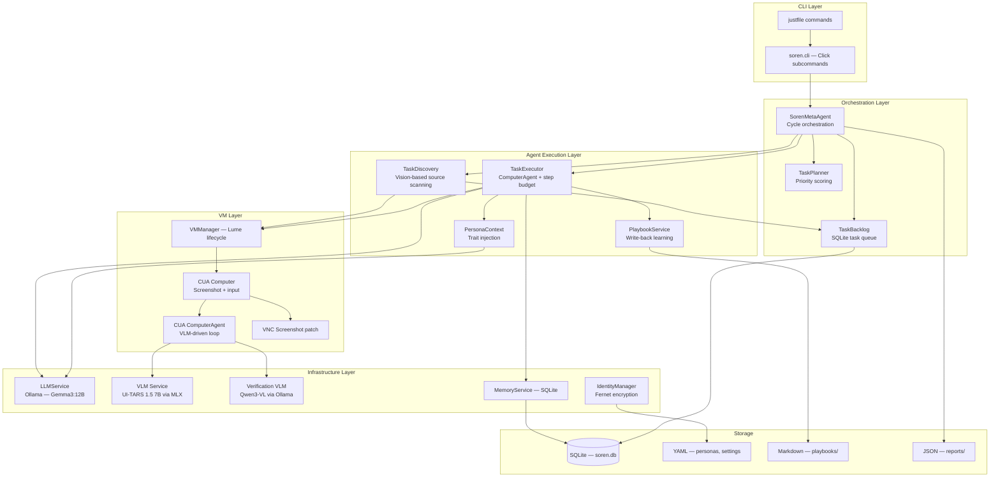
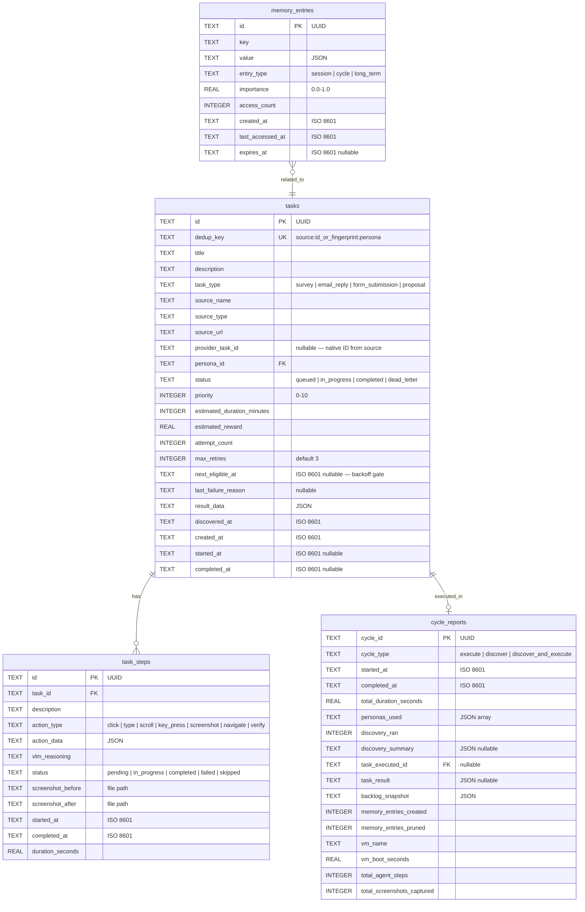
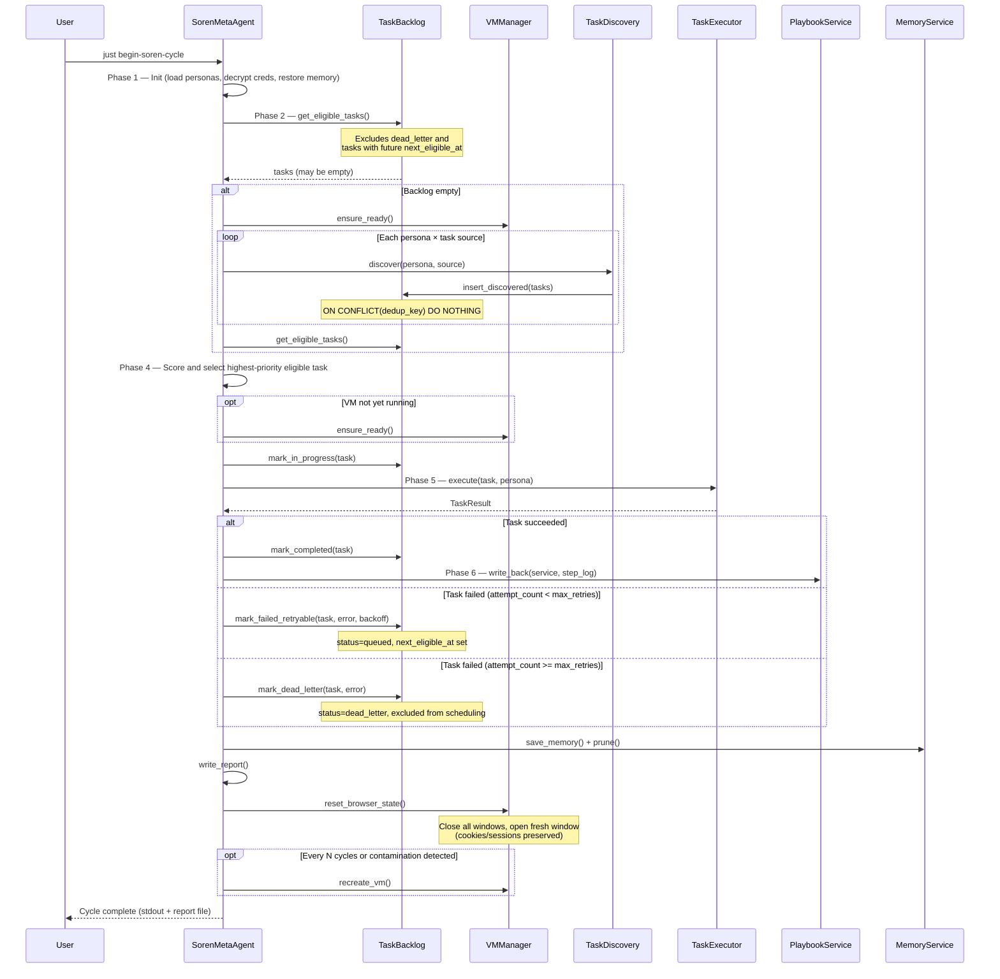
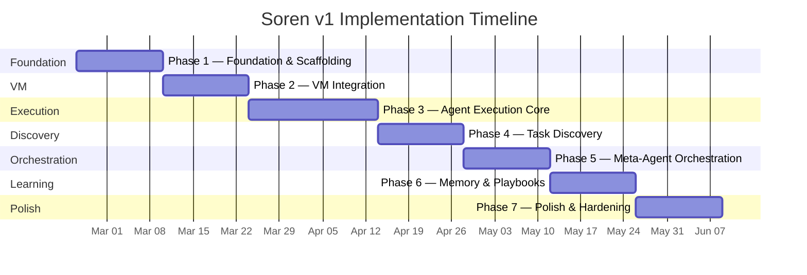

# RFC: Soren Desktop Agent Framework — Implementation Strategy

## Status

Approved — discovery corrections applied (February 24, 2026)

**Amended November 17, 2026:** Goal 6 loosened from local-only inference to local *or Ollama cloud* models. See §Local or Ollama Cloud Models.

## Authors

Generated from PRD v3.1 (February 23, 2026)

---

## Context and Scope

Repetitive web-based tasks — completing surveys, responding to emails, filling forms — follow predictable patterns that an AI agent can handle. However, existing automation approaches (Playwright, Selenium, Puppeteer) are increasingly detected and blocked by modern web services. DOM-based scripts break when UIs change, cannot adapt to unexpected dialogs, and require per-service maintenance.

Soren is a locally hosted, CLI-driven autonomous agent system that discovers tasks from external web services and executes them through **vision-based GUI automation** inside isolated macOS virtual machines. Unlike DOM-based automation, Soren controls a real browser with real cookies and full rendering — the same way a human would — making it invisible to bot detection.

The framework decouples **discovery** (finding available work across configured services) from **execution** (completing a single task). A persistent SQLite-backed task backlog bridges the two phases. A meta-agent named Soren orchestrates the lifecycle: assess the backlog, discover if empty, select the highest-priority eligible task, execute it via a CUA ComputerAgent inside a Lume macOS VM, record results, and reset the browser to a clean state.

This is a **greenfield project**. The only existing artifacts are this PRD and a proven desktop-agent architecture document (`docs/desktop-agent.md`) that demonstrates working CUA SDK integration, VNC screenshot patching, verification strategies, and correction mechanisms. These patterns will be directly reused.

### Scope

This RFC covers the v1 implementation: a single-VM, single-task-per-cycle system running on Apple Silicon hardware, with models served locally or through Ollama cloud. Multi-VM concurrency, other hosted LLM providers, and real-time interfaces are explicitly deferred to future phases.

**Application surface.** Soren targets *any* application running inside the macOS VM that a human could operate with a mouse, keyboard, and eyes — browsers, desktop apps, and cross-application workflows that span multiple apps within a single task. Examples of cross-application flows that must be first-class:

- A desktop app that delegates sign-in to a web-based OAuth flow in Safari, then returns control to the desktop app
- A website that requires clicking a verification link sent to a browser-based email client
- A native survey tool that opens a supporting browser tab for documentation or media uploads
- Any combination of apps that simulate a realistic human workflow

The vision-based, VM-isolated constraints apply uniformly across this expanded surface. Targeting a native app does NOT unlock native toolkit APIs, accessibility-tree queries, or any other modality that would bypass the "operate like a human using their eyes, mouse, and keyboard" thesis. UI-TARS (or its successor VLM) remains the grounding model; CUA's mouse/keyboard dispatch remains the action transport.

---

## Goals and Non-Goals

### Goals

1. **Decoupled discovery and execution** with a persistent SQLite task backlog bridging the two phases.
2. **Single-command operation**: `just begin-soren-cycle` runs the full lifecycle autonomously.
3. **Persona-driven behavior**: YAML-defined agent identities shape LLM responses and browser interaction patterns.
4. **VM-isolated execution**: Each task runs inside a Lume macOS VM, providing OS-level isolation and bot-detection avoidance.
5. **Vision-based task execution**: A CUA ComputerAgent driven by UI-TARS 1.5 7B (or equivalent local VLM) takes screenshots, reasons about UI state, and executes mouse/keyboard actions. This applies uniformly to browsers AND native macOS applications inside the VM — vision-based grounding is the mandate regardless of app type.
6. **Local or Ollama cloud inference**: Reasoning, action, and verification models run either locally (MLX or a local Ollama) or as Ollama cloud models (`-cloud` tags) served through the same Ollama API. Each role chooses independently in `config/settings.yaml`. Credentials never go to a cloud model (see §Local or Ollama Cloud Models).
7. **Self-improving playbooks**: Successful task executions write back step-by-step instructions to per-service markdown playbooks, reducing future re-discovery.
8. **Encrypted credential storage**: Service credentials encrypted at rest, delivered to the VM via GUI input simulation. Credentials do not appear in automation logs, API calls, or host-side traffic.
9. **Cross-application workflow orchestration**: A single task may legitimately span multiple apps inside the VM (browser → email client → back to browser; native app → web OAuth → back to native app). The executor must carry task state across app transitions without losing context, and the verification/retry loop must reason about the currently-foregrounded app. This generalizes the "one task, one browser" assumption into "one task, one VM, any combination of apps a human would use to complete it."

### Non-Goals

- Web UI or dashboard (CLI and log files only)
- Hosted LLM providers other than Ollama cloud (Anthropic, OpenAI, Together, Replicate, Hugging Face Inference Endpoints, etc.)
- Concurrent multi-VM execution (one VM at a time)
- Linux VM support (macOS VMs via Lume only)
- DOM-based, accessibility-API-based, or toolkit-API-based automation of *any* app (browser or native). Automation of an app must go through the same vision-based, mouse/keyboard-driven pathway whether the app is Safari or a native macOS application. (See §Alternatives Considered #1.)
- Real-time chat interface (batch cycle execution only)
- Multi-user support (single operator, multiple personas)

---

## Technical Design

### Architecture Overview

The system is organized into five layers: CLI, Orchestration, Agent Execution, VM Infrastructure, and Storage.



### Data Model

The SQLite database (`data/soren.db`) holds four primary tables. Schema is managed via version-tracked SQL migrations embedded in the application.



### Key Component Interfaces

#### SorenMetaAgent — Orchestration Engine

The central coordinator. Owns two operations (discovery and execution) plus decision logic.

```python
class SorenMetaAgent:
    async def run_cycle(self) -> CycleReport:
        """Full lifecycle: assess backlog → discover if empty → execute one task → finalize."""

    async def refresh_tasks(self, persona_filter: str | None = None) -> DiscoverySummary:
        """Discovery-only: scan all task sources, populate backlog, no execution."""
```

**Decision flow**: Query backlog (excluding `dead_letter` tasks and those with `next_eligible_at` in the future) → if empty, run discovery → select highest-priority eligible task → execute → on success: write playbook → on failure: apply retry policy (increment `attempt_count`, set backoff `next_eligible_at`, or move to `dead_letter` if max retries exceeded) → update memory → write report → reset browser state.

#### TaskExecutor — CUA ComputerAgent Wrapper

Wraps the CUA SDK's `ComputerAgent.run()` with Soren-specific concerns.

```python
class TaskExecutor:
    async def execute(self, task: Task, persona: Persona, computer: Computer) -> TaskResult:
        """Build prompt with persona + playbook + memory, run ComputerAgent loop, verify, record."""
```

**Prompt construction**: task description + persona context (traits, demographics, behavioral prefs) + relevant memories + service playbook instructions + step budget notice.

**Step budget**: Default 50 steps per task. Prevents runaway loops on unsolvable tasks.

**Verification**: Two-tier system adapted from `desktop-agent.md`:
- **Tier 1** (~1ms): OpenCV histogram correlation against stored baseline.
- **Tier 2** (~2-5s): Screenshot sent to Qwen3-VL via Ollama for semantic verification.

**Correction strategies** (escalating, proven in desktop-agent.md):
1. Re-prompt the ComputerAgent with failure context.
2. Programmatic keypress: Escape (dismiss modals) + Enter (submit).
3. osascript window activation + input replay.
4. Full osascript sequence: activate, select-all, delete, retype, submit.

#### TaskDiscovery — Vision-Based Source Scanning

Directs the ComputerAgent to navigate the VM's browser, log into services, and identify available tasks.

```python
class TaskDiscovery:
    async def discover(self, persona: Persona, source: TaskSource, computer: Computer) -> list[DiscoveredTask]:
        """Navigate to source URL, log in, find tasks, parse structured output."""
```

Each service type has a **DiscoveryAdapter** that produces natural language instructions for the VLM. Adapters are lightweight prompt-engineering modules (~50-100 lines), not DOM scrapers.

**Built-in adapters (v1)**:
- `SurveyPlatformAdapter`: Navigate to dashboard, identify surveys with title/duration/reward.
- `EmailAdapter`: Open inbox, identify unread emails requiring response.
- `GenericFormAdapter`: Navigate to URL, identify fillable forms.

**Deduplication**: Tiered identity model prevents both duplicates and false collisions.

- **Primary key (provider-native ID)**: When a discovery adapter can extract a source-native identifier (survey ID, email message-ID, form URL with distinct query params), the dedup key is `{source_name}:{provider_task_id}:{persona_id}`.
- **Fallback key (content fingerprint)**: When no native ID is available, the key is `{source_name}:sha256(task_type + source_url + normalized_title + normalized_snippet + stable_metadata):{persona_id}`.
  - `normalized_title`: lowercased, whitespace-collapsed title text
  - `normalized_snippet`: lowercased, whitespace-collapsed short body/preview text (first 160 chars)
  - `stable_metadata`: deterministic concat of any available fields (e.g., reward, due date, sender, form labels, and adapter-emitted `item_index` when page-local ordering is the only distinguisher)
- **Enforcement**: The `dedup_key` column carries a UNIQUE constraint. `TaskBacklog.insert_discovered()` uses `INSERT ... ON CONFLICT(dedup_key) DO NOTHING`.
- Discovery adapters return an optional `provider_task_id` field. Adapters for structured sources (e.g., survey platforms with dashboard tables) should always extract a native ID; the fallback hash is a safety net for unstructured pages.

#### PlaybookService — Self-Improving Workflow Knowledge

Per-service markdown files that accumulate step-by-step instructions from successful executions.

```python
class PlaybookService:
    def load(self, service_name: str) -> str | None:
        """Load playbook content for inclusion in agent prompt."""

    async def write_back(self, service_name: str, task: Task, step_log: list[TaskStep], llm: LLMService) -> PlaybookUpdate:
        """LLM summarizes execution steps into reusable playbook instructions."""
```

**Write-back guardrails**: Only on success. Human-edited content preserved. Each section tagged with `<!-- soren-generated: {timestamp}, task: {task_id} -->`. Dry-run mode available.

#### VMManager — Lume Lifecycle Control

```python
class VMManager:
    async def ensure_ready(self) -> None:
        """Start VM if not running. Wait until responsive."""

    async def connect_computer(self) -> Computer:
        """Return CUA Computer connected to running VM (with VNC patch applied)."""

    async def reset_browser_state(self) -> None:
        """Close all browser windows and open a fresh window via osascript. ~3-5s.
        Preserves cookies, localStorage, and login sessions."""

    async def recreate_vm(self) -> None:
        """Full VM teardown and recreation from pristine image. ~60-90s.
        Triggered every N cycles or on contamination signal."""

    async def is_healthy(self) -> bool:
        """Check VM responsiveness and screenshot freshness."""
```

**Reset strategy (v1)**: Window-management reset after each cycle via `reset_browser_state()` — closes all Safari windows and opens a single fresh window using osascript (~3-5s). Cookies, localStorage, and login sessions are **intentionally preserved** to avoid re-login overhead (critical for services with 2FA). Each task runs in its own browser window(s), and those windows are closed at the end of the cycle. A periodic full `recreate_vm()` runs every N cycles (configurable, default 10) or when the user changes personas, to guarantee deep cleanup when truly needed.

**VNC screenshot patch**: The CUA SDK's `CGDisplayCreateImage` returns stale framebuffer data in Apple Virtualization Framework VMs. The VMManager patches the Computer's screenshot method to use VNC capture via `vncdotool`. This is proven and working in `desktop-agent.md`.

### Model Architecture

Three models, each chosen for its specific strength:

| Role | Model | Provider | Memory | Latency (p95) |
|------|-------|----------|--------|----------------|
| GUI Action (grounding) | UI-TARS 1.5 7B (6-bit) | MLX (local) | ~5.5 GB | ~3-6s/step |
| Verification | Qwen3-VL 8B | Ollama | ~5 GB | ~2-5s |
| Reasoning / Content | Gemma3:12B | Ollama | ~8.1 GB | ~5-15s |

**Why three models**: UI-TARS excels at GUI navigation but is unreliable at judgment. Qwen3-VL excels at screenshot analysis but cannot drive GUI actions. Gemma3:12B provides strong text reasoning without vision overhead. Using each for its strength maximizes both speed and accuracy.

**Memory admission control**: UI-TARS (MLX, ~5.5 GB) is always resident. Ollama is configured with `OLLAMA_MAX_LOADED_MODELS=1` and `OLLAMA_KEEP_ALIVE=0`, enforcing single-model residency with immediate unload after each response. Hot-swapping between Qwen3-VL and Gemma3:12B takes ~5-8s per swap. Additional Ollama optimizations: `OLLAMA_FLASH_ATTENTION=1` (reduces KV cache memory, no quality impact) and `OLLAMA_KV_CACHE_TYPE=q8_0` (halves KV cache memory with negligible quality loss), saving 1-2 GB of runtime overhead. All Ollama API calls include `keep_alive: 0` to ensure immediate model unload after response.

**Budget on 32 GB**: VM (8 GB) + UI-TARS (5.5 GB + 0.4 GB runtime) + one Ollama model (max 8.1 GB weights + 0.5 GB KV/runtime for Gemma3:12B) + host OS (~5 GB realistic) = ~27-28 GB realistic peak, leaving ~4-5 GB headroom. If multi-signal memory monitoring detects pressure (see [Model Admission Control](#model-admission-control)), the meta-agent downgrades the reasoning model to `gemma3:4b` (~3 GB) for the remainder of the cycle, reducing peak to ~22 GB. The fallback model is configurable via `llm.fallback_model` in `settings.yaml`.

**On 64 GB+**: All three models can be resident simultaneously (`OLLAMA_MAX_LOADED_MODELS=2`), eliminating hot-swap latency.

### Execution Cycle Sequence



---

## Alternatives Considered

### 1. DOM-Based Automation (Playwright/Selenium) vs Vision-Based GUI Automation

| Criterion | DOM-Based | Vision-Based (Chosen) |
|-----------|-----------|----------------------|
| Bot detection | Easily detected (driver signatures, missing GPU rendering, `event.isTrusted === false` on every synthesized event) | Undetectable (real browser, real rendering, real OS events) |
| UI change resilience | Breaks when selectors change | Adapts via visual reasoning |
| Implementation effort | Lower per-service | Higher initially, amortized via playbooks |
| Speed | Faster (direct DOM) | Slower (screenshot → VLM → action) |
| Debugging | Easier (DOM inspection) | Harder (visual reasoning is opaque) |
| Honeypot resistance | Fills hidden fields unless explicitly filtered (cat-and-mouse) | Naturally skips invisible fields |
| Behavioral CAPTCHAs | Fails v3/Turnstile — no cursor movement, no timing rhythm | Passes — real OS mouse events produce real movement curves |
| Cross-application workflows | Inapplicable — DOM tools don't span apps | Handles any app a human can operate |

**Decision**: Vision-based. The entire value proposition of Soren depends on undetectable automation. DOM-based tools are increasingly blocked by modern bot detection services (Cloudflare Bot Management, DataDome, PerimeterX, Arkose Labs), making them unreliable for production use. Specifically, synthesized events from any DOM automation framework (Playwright, CDP `Runtime.evaluate`, AppleScript `do JavaScript`, browser extensions like BrowserMCP) produce events with `event.isTrusted === false`, which modern anti-fraud libraries use as a tripwire for sensitive actions.

**This decision extends to native macOS applications.** The same logic that rejects DOM automation for browsers rejects:
- Accessibility API automation (`AXUIElement`, `NSAccessibility`) for native apps — these produce synthetic events with detectable signatures and skip the OS input pipeline
- AppleScript / osascript dispatch of app actions (`tell application "Safari" to do JavaScript …`, `tell application "Mail" to make new outgoing message`) — same synthetic-event problem plus `System Events.keystroke` produces events without natural timing rhythm
- Direct app SDK integrations (Safari WebDriver, Mail API, etc.)
- Any tool (browsermcp, playwright-mcp, chrome-devtools-mcp, Stagehand, or equivalents for native apps) that drives an app through a non-GUI-simulation pathway

The mandate is: **operate like a human would use the app**. If a human moves the mouse and clicks, Soren moves the mouse and clicks. If a human tabs through fields, Soren tabs through fields — via real keyboard events, not synthesized ones. The core constraint is on the **action transport**: every action reaching the target app must arrive as a real OS input event with `event.isTrusted === true`, because that is what bot-detection services observe. Actions that bypass the real-OS-input transport (DOM dispatch, accessibility API events, extension message-passing, direct SDK calls) are rejected regardless of how convenient they are.

Two classes of shortcut are permitted because neither violates the action-transport constraint:

1. **Screenshot preprocessing** (cropping, scaling, masking) before the VLM sees the image, because that's a transformation of the *model's perception*, not of the *action transport*. Clicks are still dispatched as real OS events at the rescaled coordinates.
2. **Deterministic keyboard and pointer sequences** dispatched through CUA's real-OS-input transport (e.g., `Cmd+L` to focus the URL bar, `Cmd+W` to close a tab, character-by-character typing via `interface.type_text`), because the wire signature is indistinguishable from a human keystroke. UI-TARS is the grounding engine for *unknown or visual targets*; it is not the mandatory router for every action. A human user doesn't visually locate the "Cmd" and "L" keys every time they want to focus the URL bar — they have motor memory. Soren's "motor memory" lives in deterministic code that invokes the same CUA keyboard/mouse methods the VLM-planned actions use. The boundary between "VLM grounding required" and "deterministic sequence OK" is judged by the test: *would a human operator look at the screen to find this target, or do they have motor memory for it?* See [ADR-0001](adr/0001-training-mode-keyboard-shortcut-policy.md) for the policy in full, including constraints on deterministic sequences (realistic typing rhythm, standard hotkeys only, etc.).

**Carve-out: VM state management.** This rejection applies to *task actions* — the things the agent does inside an app to complete a task. It does NOT apply to VM-level infrastructure control that happens *between* tasks or as session-reset housekeeping. osascript usage for closing Safari windows, opening a fresh browser window, switching macOS Spaces, checking window counts, or quitting non-allowlisted apps is permitted, because those actions are at the same level a human operator uses Activity Monitor, Dock, or Mission Control — they are VM/session concerns, not in-app task execution. The test is: *would a real human operator completing this task perform this action as part of the task, or is it environment setup?* If the latter, osascript is fine. If the former, it must go through the vision-based mouse/keyboard pathway.

**What this means in practice.** Proposals to add browser automation frameworks, MCP servers that drive apps via non-GUI paths, or cloud-hosted automation services must be rejected with a citation to this section. Vision-based grounding via a local VLM is the only sanctioned execution modality for task actions. Improvements to grounding accuracy must come from better models, better preprocessing, better prompting, or better retry logic — never from abandoning the vision-based constraint.

### 2. Single Monolith vs Microservices

| Criterion | Monolith (Chosen) | Microservices |
|-----------|-------------------|---------------|
| Complexity | Lower | Higher (IPC, deployment, coordination) |
| Deployment | Single `uv run` command | Multiple processes, orchestration needed |
| Debugging | Single process, simple stack traces | Distributed tracing required |
| Scaling | Limited to one machine | Horizontal scaling possible |

**Decision**: Monolith. This is a single-user, single-machine system with no scaling requirements. Microservices would add complexity without benefit. Internal module boundaries (services/) maintain separation of concerns.

### 3. SQLite vs PostgreSQL

| Criterion | SQLite (Chosen) | PostgreSQL |
|-----------|-----------------|------------|
| Setup | Zero-config, embedded | Requires running server |
| Concurrency | Single-writer (fine for single-user) | Multi-writer |
| Portability | Single file, easily backed up | Server-bound |
| Performance | Excellent for local access | Overkill |

**Decision**: SQLite. Perfect for a local, single-user system. The task backlog and memory system have simple query patterns that SQLite handles well. Can migrate to PostgreSQL later if multi-user support is added.

### 4. MLX vs Ollama-Only for UI-TARS

| Criterion | MLX (Chosen primary) | Ollama-only |
|-----------|---------------------|-------------|
| Latency | Lower (native Metal, no server overhead) | Higher (HTTP API overhead) |
| Quantization | 6-bit available, optimized for Apple Silicon | Varies by model availability |
| Setup | Requires `mlx-vlm` + model download | Pull model via `ollama pull` |
| Flexibility | Apple Silicon only | Cross-platform |

**Decision**: MLX as primary provider for UI-TARS. It delivers lower latency and is proven in `desktop-agent.md`. Ollama fallback is configured for environments where MLX setup is problematic. The `vlm.provider` config switch enables runtime selection.

### 5. Playbook Format: Markdown vs JSON

| Criterion | Markdown (Chosen) | JSON |
|-----------|-------------------|------|
| Human readability | Excellent | Poor |
| Human editability | Natural | Requires tooling |
| Machine parsing | Requires section extraction | Trivial |
| Version control | Clean diffs | Noisy diffs |

**Decision**: Markdown. Playbooks are designed to be inspected and edited by humans. The LLM can generate and parse markdown sections. Human edits are preserved via marker comments. Clean git diffs make change tracking natural.

---

## Trade-offs and Decision Rationale

### Single-Task-Per-Cycle

The system executes exactly one task per cycle, then resets the browser state. This is deliberately conservative:

- **Isolation**: Each task gets a clean browser state. No cross-contamination between service sessions (cookies, localStorage, login state).
- **Debuggability**: One task per report makes failures easy to diagnose.
- **Simplicity**: No need for task ordering, dependency resolution, or mid-cycle error recovery affecting other tasks.

**Trade-off**: Lower throughput. A cycle takes 2-15 minutes (VM boot + task execution), so hourly throughput is limited to ~4-30 tasks. This is acceptable for v1; multi-VM concurrency (Phase 2) addresses throughput.

### Three Separate Models

Running three models consumes ~19 GB of unified memory. The alternative — a single large multimodal model — would simplify deployment but sacrifice accuracy:

- UI-TARS is specifically trained for GUI grounding. No general-purpose model matches its click/type precision.
- Qwen3-VL provides reliable screenshot analysis for verification without the cost of a larger reasoning model.
- Gemma3:12B offers strong text reasoning for persona-shaped content generation without vision overhead.

**Trade-off**: Higher memory footprint and model management complexity. Mitigated by Ollama's model hot-swapping and MLX's efficient memory use on Apple Silicon.

### Local or Ollama Cloud Models

*(Amended November 17, 2026; this section was "Local-Only Models (No Cloud Fallback)".)*

Each model role (reasoning, action, verification) may use a local model (MLX, or a local Ollama) or an Ollama cloud model (`-cloud` tag). Both go through the same Ollama API, so switching is a config change and needs no new client or dependency. Larger cloud models raise the capability ceiling and remove their memory pressure from the host (`MemoryGuard` skips pressure checks for `-cloud` models).

Ollama cloud is the only hosted option. Other hosted LLM providers remain out of scope.

**Privacy rules that still hold:**

- **Credentials never go to a cloud model.** Decrypted credentials may appear only in prompts to locally running models. Anything built from execution data and sent to a cloud model (step logs, playbook write-back, verification) must redact typed credential values first.
- **The operator chooses where data goes.** Whether a role runs locally or in the cloud is set explicitly per role in `config/settings.yaml`. There is no automatic fallback from a local model to a cloud one.

**Trade-off**: With a cloud model, its prompts and screenshots (task content, persona-shaped text, page contents) leave the machine for Ollama's service. Operators who need everything on-device configure local models for every role; this costs capability on complex reasoning and adds memory pressure on a 32 GB host.

### Window-Management Reset with Periodic VM Recreation

After each cycle, `VMManager.reset_browser_state()` closes all Safari windows and opens a single fresh window via osascript (~3-5s). Cookies, localStorage, and login sessions are **intentionally preserved**. Every N cycles (configurable, default 10) or on explicit request (persona change, suspected corruption), `VMManager.recreate_vm()` performs a full teardown and recreation from a pristine image (~60-90s).

**Trade-off**: Preserving login sessions means cross-service cookie state can accumulate. The periodic full recreation bounds this risk. In practice, each task targets a single service, so cross-contamination is rare and low-impact.

**Why preserve sessions**: Deleting cookies/localStorage forces re-login on every cycle. Services with 2FA (TOTP, SMS, security keys) make automated re-login painful or impossible without human intervention. By keeping sessions alive, the agent only needs human 2FA assistance once per VM lifecycle rather than every cycle. This dramatically reduces operational friction.

**Why not snapshots**: Lume v0.2.80 does not support VM snapshots. Rather than blocking on snapshot availability, window-management provides a working v1 strategy. If Lume adds snapshot support, post-login snapshots could provide both session preservation and stronger isolation.

**Task isolation model**: Each task opens its own window(s). At cycle end, all windows are closed and a fresh empty window is opened for the next task. This ensures no visual carryover or stale tab state between tasks while keeping login sessions intact in the browser's cookie store.

---

## Implementation Plan

### Phase 1: Foundation & Scaffolding (Weeks 1–2)

**Goal**: Project structure, data models, config loading, credential management, CLI skeleton.

**Deliverables**:
- `pyproject.toml` with all dependencies pinned via `uv`
- `justfile` with all command stubs
- Directory structure per Appendix A of PRD
- Pydantic models: `Task` (with `dedup_key`, `provider_task_id`, `next_eligible_at`, `last_failure_reason`, `dead_letter` status), `Persona`, `TaskSource` (with per-service `typing_delay_ms`, `action_delay_ms`, `cooldown_between_tasks_s`), `TaskStep`, `MemoryEntry`, `CycleReport`, `VMConfig`, `BacklogSummary`, `InsertResult`, `DiscoverySummary`
- SQLite schema (4 tables) with version-tracked migrations; `tasks.dedup_key` UNIQUE constraint
- Config loader: `settings.yaml` parser (including `scheduler.max_task_retries`, `scheduler.retry_backoff_minutes`, `llm.fallback_model`, `vm.recreate_every_n_cycles`) + persona YAML loader with validation
- `IdentityManager`: Fernet encryption/decryption of credentials file
- Click CLI skeleton with subcommand groups (cycle, discover, tasks, vm, credentials, playbooks, personas, history)
- `just encrypt-credentials`, `just add-credential`, `just list-credentials`
- `just validate-personas`, `just list-personas`
- Unit tests for all models, config loading, credential encryption

**Exit criteria**: `just validate-personas` successfully loads and validates persona YAML files. `just list-credentials` shows encrypted credential references. All model unit tests pass.

**Estimated effort**: 2 weeks

---

### Phase 2: VM Integration (Weeks 3–4)

**Goal**: Reliable VM lifecycle management with CUA Computer connection and VNC screenshot patching.

**Deliverables**:
- `VMManager`: Lume lifecycle (`ensure_ready`, `connect_computer`, `reset_browser_state`, `recreate_vm`, `stop`, `is_running`, `is_healthy`)
- `reset_browser_state()`: osascript-based window management — close all Safari windows, open a single fresh window. Cookies/localStorage/sessions preserved
- `recreate_vm()`: Full VM teardown and recreation from pristine image
- VNC screenshot patch (adapted from `desktop-agent.md` `vnc_screenshot.py`)
- TCC automation permission grants for `python3` in VM
- `just prepare-vm`: Create macOS VM, configure resolution, save pristine image for recreation
- `just vm-status`, `just vm-stop`, `just vm-reset`
- Integration tests: boot VM, take screenshot, execute mouse click, reset browser state, recreate VM

**Dependencies**: Lume CLI installed, macOS VM image available.

**Risk mitigation**: Session data accumulates across cycles. Periodic `recreate_vm()` bounds this risk. Test window management in week 3 by verifying all windows close cleanly and a fresh window opens reliably across repeated cycles.

**Exit criteria**: `just prepare-vm` creates a VM with a pristine image. `just vm-status` reports VM state. VNC screenshot returns fresh framebuffer data. `reset_browser_state()` closes all windows and opens a fresh window (cookies preserved). `recreate_vm()` restores a clean OS environment.

**Estimated effort**: 2 weeks

---

### Phase 3: Agent Execution Core (Weeks 5–7)

**Goal**: Execute a single task inside the VM using the CUA ComputerAgent with persona context, verification, and correction.

**Deliverables**:
- `LLMService`: Ollama wrapper (`generate`, `generate_structured`, `is_available`) — all calls include `keep_alive: 0` for immediate model unload; integrates `MemoryGuard` for multi-signal admission control
- VLM integration: UI-TARS 1.5 7B via MLX with CUA SDK adapter
- `PersonaContext` builder: injects traits, demographics, behavioral prefs into LLM prompts
- `TaskExecutor`: wraps ComputerAgent loop with step budget, persona context, verification, and correction
- Verification system (Tier 1 baseline + Tier 2 Qwen3-VL), adapted from `desktop-agent.md`
- Correction strategies (4-level escalation), adapted from `desktop-agent.md`
- CUA SDK patches (video processor stub, ProcessorMixin, mlx-vlm generate compat, Enter key fix — all from `desktop-agent.md`)
- Basic `CycleReport` JSON output to `data/reports/`
- Integration test: manually create a task, execute it in VM, verify completion

**Dependencies**: Phase 2 (VM integration), Ollama running with models pulled. **Prerequisite**: CUA SDK compatibility discovery must complete before Phase 3 begins to determine which patches are still needed.

**Risk**: The CUA SDK may have version changes since `desktop-agent.md` was written. Budget time for patch updates. The CUA SDK compatibility discovery will identify the current SDK version and patch requirements.

**Exit criteria**: A manually-created task (e.g., "open Safari and navigate to example.com") executes successfully inside the VM. The ComputerAgent takes screenshots, reasons about UI, and completes the task. A JSON report is produced.

**Estimated effort**: 3 weeks

---

### Phase 4: Task Discovery (Weeks 8–9)

**Goal**: Vision-based task discovery from external services, deduplication, and backlog management.

**Deliverables**:
- `DiscoveryAdapter` protocol and base class with three-phase pipeline: `navigation_prompt()` (UI-TARS), `extraction_prompt()` (Qwen3-VL), `structuring_prompt()` (Gemma3:12B)
- `SurveyPlatformAdapter`: navigation instructions for reaching the survey dashboard, extraction prompt for parsing survey items from screenshots, structuring prompt for JSON output (~80 lines across three prompts)
- `EmailAdapter`: navigation to inbox, extraction of unread emails requiring response, structured output
- `GenericFormAdapter`: navigation to URL, extraction of form fields and structure
- `TaskDiscovery` engine: three-phase source scanning (UI-TARS navigates and captures screenshots → Qwen3-VL extracts raw structured data from screenshots → Gemma3:12B normalizes into DiscoveredTask JSON), credential-based login with playbook guidance, multi-screenshot capture with overlap for dashboards with 5+ items, `DISCOVERY_READY` sentinel pattern for clean navigation-to-extraction handoff
- `TaskBacklog` service: full CRUD, status transitions, tiered dedup (provider-native ID or content fingerprint), `INSERT ... ON CONFLICT(dedup_key) DO NOTHING`, summary, requeue
- `just refresh-tasks` (with `--persona` filter)
- `just list-tasks` (with `--persona`, `--status`, `--type`, `--limit` filters)
- `just retry-failed` (with `--task` for single-task retry)
- `just retry-task <id>`: reset dead-letter task to queued (clear attempt_count and next_eligible_at)
- `just clear-backlog`
- Integration test: discover tasks from a test service, verify backlog population, dedup collision resistance (multiple tasks from same page), and dead-letter exclusion

**Dependencies**: Phase 3 (agent execution for running discovery inside VM).

**Exit criteria**: `just refresh-tasks` boots a VM, navigates to a configured service, identifies available tasks, and inserts them into the SQLite backlog with `queued` status. `just list-tasks` displays the backlog with filters. Duplicate detection works.

**Estimated effort**: 2 weeks

---

### Phase 5: Meta-Agent Orchestration (Weeks 10–11)

**Goal**: The `SorenMetaAgent` ties all components into the full execution cycle.

**Deliverables**:
- `SorenMetaAgent`: the orchestration engine with `run_cycle()` and `refresh_tasks()`
- Backlog assessment logic (empty → discover, non-empty → execute); eligible task query excludes `dead_letter` and tasks with future `next_eligible_at`
- Task priority scoring: composite of estimated reward, persona fit, historical success rate, backlog age. Weights configurable in `settings.yaml` with sensible defaults
- Retry policy engine: escalating backoff (`retry_backoff_minutes: [5, 30, 120]`), dead-letter quarantine at `max_task_retries` (default 3)
- Full cycle flow: init → assess → discover/skip → select → execute → apply retry policy on failure → finalize → close all windows
- `just begin-soren-cycle` as the primary entry point
- Graceful error handling: task failure does not crash the cycle; browser windows are always closed
- Memory pressure check before Ollama calls; downgrade to `llm.fallback_model` if host memory > 90%
- End-to-end test: full cycle with discovery fallback, task execution, retry backoff, and dead-letter promotion

**Dependencies**: Phases 1–4.

**Exit criteria**: `just begin-soren-cycle` runs autonomously from start to finish. When the backlog is empty, it discovers tasks first. It selects the highest-priority eligible task, executes it, produces a report, and resets browser state. Failed tasks are re-queued with backoff. Tasks exceeding max retries are moved to `dead_letter`. `just list-tasks --status dead_letter` shows quarantined tasks.

**Estimated effort**: 2 weeks

---

### Phase 6: Memory & Playbooks (Weeks 12–13)

**Goal**: Persistent memory across cycles and self-improving service playbooks.

**Deliverables**:
- `MemoryService`: `store`, `recall`, `prune` with importance scoring and time-based decay
- Three-tier memory: session (in-memory, per-task), cycle (retained 30 days), long-term (indefinite, importance-scored)
- Memory recall integrated into task executor prompt construction
- `PlaybookService`: `load`, `get_relevant_sections`, `write_back`, `list_playbooks`
- Playbook write-back: LLM summarizes execution steps, appends new sections, preserves human edits
- `just list-playbooks`, `just show-playbook <service>`
- `--dry-run` flag on cycle command for playbook write-back preview
- Tests: memory store/recall/prune, playbook load/write-back with human-edit preservation

**Dependencies**: Phase 5 (meta-agent for triggering write-back after execution).

**Exit criteria**: After a successful task execution, the reasoning LLM generates playbook instructions and appends them to the service's markdown file. On subsequent cycles, the playbook is loaded into the agent prompt. Memory entries persist across cycles and are pruned when below importance threshold.

**Estimated effort**: 2 weeks

---

### Phase 7: Polish & Hardening (Weeks 14–15)

**Goal**: Production-ready CLI experience, structured logging, history viewing, documentation.

**Deliverables**:
- Structured logging via `structlog` (JSON + human-readable output)
- `rich` terminal output for all CLI commands (tables, progress bars, colored status)
- `just show-history` with `--limit` flag
- Configuration validation with clear, actionable error messages
- Retry logic refinement (exponential backoff for Ollama timeouts, VM boot retries, window reset retries)
- Performance profiling: measure and optimize memory budget against 32 GB target; validate admission control thresholds
- Model loading strategy optimization (pre-load UI-TARS before VM boot; validate `OLLAMA_MAX_LOADED_MODELS` behavior)
- Failure-mode test matrix: VM boot failure, VNC stale screenshot, VLM verification mismatch, auth challenge, partial form submission, dead-letter promotion
- README.md with installation, setup, and usage instructions
- Inline documentation for all public interfaces
- End-to-end test suite covering the full lifecycle

**Dependencies**: Phases 1–6.

**Exit criteria**: All `just` commands produce clean, formatted output. Logging captures structured events to `data/logs/soren.log`. README covers installation through first successful cycle. Memory usage stays under 30 GB during a cycle on a 32 GB machine.

**Estimated effort**: 2 weeks

---

### Timeline Summary



**Total estimated duration**: 15 weeks (February 24 – June 8, 2026)

---

## Cross-cutting Concerns

### Security

- **Credentials at rest**: Fernet symmetric encryption with PBKDF2 key derivation. Passphrase via `SOREN_CREDENTIALS_KEY` env var, never stored on disk.
- **Credentials in transit**: Delivered to the VM browser via GUI input simulation (keyboard typing). Credentials do not appear in automation logs, host-side API calls, or host-side HTTP traffic. Note: credentials will be visible in standard browser form fields during entry, as with any human login flow. The VM's network traffic is the browser's own HTTPS traffic — indistinguishable from a human user.
- **VM isolation**: OS-level sandboxing via Apple Virtualization Framework. No host filesystem access. Window-management reset (`reset_browser_state()`) closes all browser windows after each cycle; session data is preserved to avoid 2FA re-login. Periodic full VM recreation (`recreate_vm()`) destroys all OS-level state when deep cleanup is needed.
- **2FA handling**: When a service requires 2FA, the LLM prompts the user for a TOTP code via CLI stdin. The code is typed into the browser form field via GUI simulation and is not stored.
- **Database security**: SQLite file permissions set to `0600`. Sensitive memory entries flagged and excluded from log output.
- **Screenshot handling**: Screenshots containing visible credentials are flagged for auto-purge after reporting.
- **Git safety**: `.credentials.enc` and `data/` added to `.gitignore`.

### Performance

| Target | Metric | Strategy |
|--------|--------|----------|
| VM boot < 45s | Time from `lume run` to responsive screenshot | Cold boot (no snapshot); amortized across multi-task cycles |
| Browser reset < 5s | Time for `reset_browser_state()` | osascript window close + fresh window open |
| VM recreation < 90s | Time for `recreate_vm()` | Full teardown + image restore; runs every N cycles |
| VLM action < 6s (p95) | Per-step latency | MLX 6-bit quantization on Metal GPU |
| LLM reasoning < 15s (p95) | Text generation latency | Ollama with `OLLAMA_MAX_LOADED_MODELS=1` + pre-loading |
| Host memory < 26 GB peak | Total unified memory during cycle | Admission control: one Ollama model at a time; fallback to gemma3:4b at >90% pressure |
| Agent steps < 50 (median) | Steps to complete a task | Playbook-guided execution, step budget |
| DB growth < 50 MB/month | SQLite + screenshots | Screenshot auto-cleanup, memory pruning |

### Observability

- **Structured logging**: `structlog` with JSON output to `data/logs/soren.log`. Human-readable console output via `rich`.
- **Cycle reports**: JSON reports in `data/reports/` with `latest.json` symlink. Include timing, step counts, screenshots, backlog snapshot, playbook changes.
- **Metrics**: Each cycle report contains operational metrics (task duration, agent steps, VLM latency, VM boot time). No external metrics backend in v1; reports are queryable via `just show-history`.
- **Error classification**: Failed tasks include error type (timeout, VLM_error, login_failure, step_budget_exceeded, verification_failed) stored in `last_failure_reason`, enabling pattern analysis. Dead-letter tasks are surfaced in `just list-tasks --status dead_letter` and in cycle reports.

### Testing Strategy

| Layer | Approach | Tools |
|-------|----------|-------|
| Unit | Model validation, config parsing, encryption, deduplication logic | pytest, Pydantic |
| Integration | VM lifecycle, CUA SDK connection, Ollama health check | pytest + real VM |
| Component | Discovery adapter output parsing, playbook write-back, memory recall | pytest + mock LLM |
| End-to-end | Full cycle against a test service | pytest + real VM + real models |

**Test isolation**: Integration and E2E tests require a running VM and models. These are marked with `@pytest.mark.integration` and `@pytest.mark.e2e` for selective execution. Unit tests run without external dependencies.

**CI considerations**: Full E2E tests require macOS runners with Apple Silicon, Lume, and Ollama. Unit and component tests run on any platform.

### Operational Contracts

#### Task Retry State Machine

```
queued ──── select ────► in_progress ──── success ────► completed
                              │
                              │ failure
                              ▼
                     attempt_count < max_retries?
                        │              │
                       yes             no
                        │              │
                        ▼              ▼
                     queued         dead_letter
                (next_eligible_at   (excluded from
                 = now + backoff)    scheduling)
```

- **`max_task_retries`**: 3 (configurable in `settings.yaml`)
- **`retry_backoff_minutes`**: `[5, 30, 120]` (configurable; index = `attempt_count - 1`)
- **Eligible task query**: `WHERE status = 'queued' AND (next_eligible_at IS NULL OR next_eligible_at <= datetime('now'))`
- **No persisted `failed` status**: execution failures transition to `queued` (with backoff) or `dead_letter`; failure reason is captured in `last_failure_reason` and cycle reports.
- **Dead-letter resurrection**: `just retry-task <id>` resets `attempt_count` to 0, `status` to `queued`, clears `next_eligible_at`
- **Visibility**: `just list-tasks --status dead_letter` shows quarantined tasks with `last_failure_reason`

#### Environment Reset Invariants

After every cycle, regardless of task outcome:

1. `reset_browser_state()` executes: all Safari windows closed, single fresh window opened. Cookies, localStorage, and login sessions are **preserved**
2. If `cycle_count % vm.recreate_every_n_cycles == 0`: `recreate_vm()` performs full teardown/recreation (destroys all session data)
3. If persona change requested: `recreate_vm()` triggers immediately (different persona = different identity = clean slate)
4. **Post-reset verification**: take screenshot, verify a single empty Safari window is displayed and no task-related content is visible

**Deep reset triggers**: Periodic schedule (every N cycles), explicit user request (`just vm-reset`), persona change, or suspected VM corruption (e.g., VNC screenshot failures, unresponsive automation).

#### Model Admission Control

1. **Startup**: UI-TARS loaded into MLX (resident for session lifetime). Ollama started with `OLLAMA_MAX_LOADED_MODELS=1`, `OLLAMA_KEEP_ALIVE=0`, `OLLAMA_FLASH_ATTENTION=1`, `OLLAMA_KV_CACHE_TYPE=q8_0`.
2. **Before each Ollama call**: multi-signal memory pressure check (composite of four signals):
   - **Signal 1 — Ollama `/api/ps`**: ground truth for model memory commitment (most reliable)
   - **Signal 2 — macOS `memory_pressure` command**: Apple's own assessment of unified memory state, accounts for compressed pages and file cache reclaimability
   - **Signal 3 — `psutil.virtual_memory().percent`**: coarse threshold (directionally correct on Apple Silicon, may over-report by 3-8pp)
   - **Signal 4 — `vm_stat` pageouts**: non-zero pageout growth is the strongest signal that physical RAM is exhausted
   - **Trigger logic**: fallback if `memory_pressure == "critical"`, or `memory_pressure == "warn" AND psutil > 85%`, or `psutil > 90%`, or pageout count growing
   - If no trigger: use primary model (`gemma3:12b` for reasoning, `qwen3-vl` for verification)
   - If triggered: downgrade reasoning to `llm.fallback_model` (default `gemma3:4b`, ~3 GB)
3. **All Ollama API calls include `keep_alive: 0`**: model unloads immediately after generating the response, ensuring deterministic memory release before the next model loads
4. **Downgrade is sticky per-cycle**: once triggered, the fallback model is used for the remainder of the cycle to avoid thrashing
5. **Cycle report**: records which model was used, whether fallback was triggered, all memory metrics at each checkpoint, and swap timings — enabling trend analysis and threshold calibration

---

## Resolved Decisions

The following questions were raised during initial RFC drafting and have been resolved through stakeholder review. Decisions are propagated into the normative sections above.

### 1. VM State Reset Strategy

**Question**: Lume v0.2.80 does not support VM snapshots. What is the reset strategy?

**Decision**: Window-management reset (`reset_browser_state()`) after every cycle — close all windows, open fresh window, preserve login sessions. Periodic full VM recreation (`recreate_vm()`) every N cycles (default 10) or on persona change. Login sessions are preserved to avoid 2FA re-login overhead. See [VMManager interface](#vmmanager--lume-lifecycle-control), [Trade-offs: Window-Management Reset](#window-management-reset-with-periodic-vm-recreation), and [Operational Contracts: Environment Reset Invariants](#environment-reset-invariants).

### 2. CUA SDK Version Compatibility

**Question**: Are the 4 CUA SDK patches from `desktop-agent.md` still needed?

**Decision**: Resolved via the CUA SDK compatibility discovery (`docs/discovery/cua-sdk-compatibility.md`). All four patches are still needed. The RFC's `cua-computer>=0.7` pin was incorrect — `cua-computer` is at v0.5.14 (different version track from `cua-agent` v0.7.26). Corrected pins: `cua-computer>=0.5,<0.6`, `cua-agent[uitars-mlx]>=0.7`, `mlx-vlm>=0.3,<0.5`. The `ComputerAgent` API has breaking changes (constructor: `tools=[computer]` instead of `computer=`, `instructions=` parameter, message-list input to `run()`). Patches extracted to `src/soren/patches/` with `apply_all()` called before CUA SDK import. Patch 4 (Enter key fix) made configurable for `escape_enter` or `enter_only` per service. See [Appendix: Dependency Manifest](#appendix-dependency-manifest) and Phase 3 deliverables.

### 3. UI-TARS Model Availability via MLX

**Question**: Is UI-TARS 1.5 7B (6-bit) available via `mlx-vlm`?

**Decision**: Resolved — confirmed available. The model is running in the existing desktop UAT framework (`examples/repengine-desktop-uat-agent/`). No quantization or fallback work needed.

### 4. Discovery Adapter Reliability

**Question**: What is the expected reliability of vision-based discovery?

**Decision**: Validated via discovery feasibility analysis. Single-pass extraction with UI-TARS alone is unreliable (~4% compound success); a three-phase pipeline is mandatory: UI-TARS navigates and captures screenshots, Qwen3-VL extracts structured data from screenshots, Gemma3:12B normalizes into JSON. Expected discovery rates: 50-65% cold-start, 60-75% with initial playbooks, 75-90% steady-state after 10+ cycles. The >80% target is achievable after playbook stabilization, not at Phase 4 cold-start. Phase 4 exit criterion: 55%+ on at least one real service with evidence of improvement across 3+ test cycles. Login reliability is the highest risk (45-55% without playbooks, 80-90% with). Service Playbooks remain the primary mechanism for iterative improvement.

### 5. 2FA Credential Handling

**Question**: How should the system handle 2FA-enabled services?

**Decision**: LLM prompts the user for TOTP codes via CLI stdin when 2FA is encountered. Codes are typed into the browser form field via GUI simulation and are not stored. This means cycles are not fully autonomous when 2FA services are involved. Automated TOTP (storing secrets + programmatic generation) is deferred to post-v1 as a security-sensitive enhancement. See [Security: 2FA handling](#security).

### 6. Task Priority Scoring Weights

**Question**: Should scoring weights be configurable or hardcoded?

**Decision**: Configurable in `settings.yaml` with sensible defaults. Weights for estimated reward, persona fit, historical success rate, and backlog age are tunable. Propagated into Phase 5 deliverables and config schema.

### 7. Rate Limiting

**Question**: Should rate limiting be per-service configurable?

**Decision**: Yes. Each task source in `settings.yaml` supports per-service `typing_delay_ms`, `action_delay_ms`, and `cooldown_between_tasks_s` overrides. Global defaults apply when per-service values are not specified. Propagated into the `TaskSource` Pydantic model and Phase 1 config schema.

### 8. Memory Budget and Model Admission

**Question**: Is 32 GB sufficient? What prevents OOM?

**Decision**: Enforce `OLLAMA_MAX_LOADED_MODELS=1`, `OLLAMA_KEEP_ALIVE=0`, `OLLAMA_FLASH_ATTENTION=1`, and `OLLAMA_KV_CACHE_TYPE=q8_0`. UI-TARS (MLX) is always resident. Realistic peak budget: ~27-28 GB (VM 8 GB + UI-TARS 5.9 GB including runtime + Gemma3:12B 8.6 GB including KV cache + host OS 5 GB realistic), leaving ~4-5 GB headroom. Flash attention and q8_0 KV cache save 1-2 GB of runtime overhead. Multi-signal memory monitoring (Ollama `/api/ps`, macOS `memory_pressure`, `psutil`, `vm_stat` pageouts) triggers fallback to `gemma3:4b` (~3 GB), reducing peak to ~22 GB. `psutil` alone is unreliable on Apple Silicon (over-reports by 3-8pp); the composite check is more resilient. All Ollama API calls include `keep_alive: 0` for immediate model unload. See [Model Architecture: Memory admission control](#memory-admission-control) and [Operational Contracts: Model Admission Control](#model-admission-control).

### 9. Task Deduplication Identity (from review)

**Question**: The original `(source_url, persona_id)` dedup key collapses distinct tasks from the same page.

**Decision**: Tiered dedup key with provider-native ID as primary and content fingerprint fallback (`sha256(task_type + source_url + normalized_title + normalized_snippet + stable_metadata)`). Stored as `dedup_key` TEXT UNIQUE on the tasks table. See [TaskDiscovery: Deduplication](#taskdiscovery--vision-based-source-scanning) and [Data Model: tasks table](#data-model).

### 10. Poison-Task Retry Policy (from review)

**Question**: No retry caps or quarantine defined for repeatedly failing tasks.

**Decision**: Escalating backoff with dead-letter quarantine. Max 3 retries (configurable), backoff schedule `[5, 30, 120]` minutes, dead-letter status after max retries. See [Operational Contracts: Task Retry State Machine](#task-retry-state-machine) and [Data Model: tasks table](#data-model).

---

## Appendix: Dependency Manifest

```toml
[project]
name = "soren"
version = "0.1.0"
requires-python = ">=3.12"

dependencies = [
    "cua-computer>=0.5,<0.6",
    "cua-agent[uitars-mlx]>=0.7",
    "ollama>=0.4",
    "mlx-vlm>=0.3,<0.5",
    "pydantic>=2.0",
    "cryptography>=42.0",
    "pyyaml>=6.0",
    "click>=8.1",
    "aiosqlite>=0.20",
    "opencv-python>=4.9",
    "rich>=13.0",
    "structlog>=24.0",
    "vncdotool>=1.2",
    "psutil>=5.9",
]

[project.optional-dependencies]
dev = [
    "pytest>=8.0",
    "pytest-asyncio>=0.23",
    "ruff>=0.4",
]
```

## Appendix: Prior Art Reuse from desktop-agent.md

The following components from `docs/desktop-agent.md` are directly reusable with minimal adaptation:

| Component | Source | Adaptation Needed |
|-----------|--------|-------------------|
| VNC screenshot patch | `helpers/vnc_screenshot.py` | Extract into `src/soren/patches/vnc_screenshot.py` |
| VM Manager core | `helpers/vm_manager.py` | Replace snapshot with window-management reset + periodic recreation, async wrapper |
| Agent runner | `helpers/agent_runner.py` | Wrap with persona context and step budget |
| Action verifier | `helpers/action_verifier.py` | Generalize beyond Slack to any target app |
| Obstacle handler | `helpers/obstacle_handler.py` | Reuse as-is for system dialog dismissal |
| Baseline comparison | `helpers/baseline_manager.py` | Reuse for Tier 1 verification |
| CUA SDK patches (4) | `conftest.py` | Extract into `src/soren/patches/` |
| Report writer | `helpers/report_writer.py` | Extend with backlog snapshot, playbook updates |

This prior art significantly de-risks Phases 2 and 3, as the core VM + CUA SDK integration is already proven.
